# 로드마켓 1차 데모 둘러보기

이 문서는 로드마켓 데모를 에뮬레이터 두 대와 폰 화면으로 돌려 보며 찍은 사진과 기록이에요.
새 흐름은 맨 앞 「지금 데모 한 바퀴」에 있어요. 등록부터 경로 추천까지 여덟 장면이에요.
그 뒤의 옛 절은 버튼 모양과 일부 문구가 바뀌기 전에 찍은 사진이에요. 항목 번호는 요건표(`11_로드마켓_기능요건.md`)와 같아요.
소리는 안 나서 "앱 목소리:"와 "글레오:"라는 글로 적었어요.
영상 파일(`demo_shots/영상_두대_A_파는차.mp4`, `영상_두대_B_사는차.mp4`, `영상_사는흐름.mp4`, `영상_파는흐름.mp4`)은 모두 옛 흐름이에요.

---

## 지금 데모 한 바퀴

차 화면 사진은 Pleos Connect 에뮬레이터에서, 폰 화면 사진은 폰 크기로 찍었어요.

### 등록

1. 파는 사람이 차 화면의 「파는 물건」에서 「물건 올리기」를 눌러요. 이름, 가격, 설명을 넣고 「차에 있음」이나 「집에 있음」을 골라요. (S-03, S-40, S-41)
2. 올린 물건은 줄마다 위치 배지와 상태가 보여요. 아래 사진에는 "집에 있음 · 판매 중"인 캠핑 의자와 "차에 있음 · 숨김"인 차량용 방향제가 있어요. 줄 아래에 「수정」「숨기기」(숨기면 「다시 보이기」)「판매 완료로」「내리기」가 있어요. (S-01, S-44, S-45, S-46)
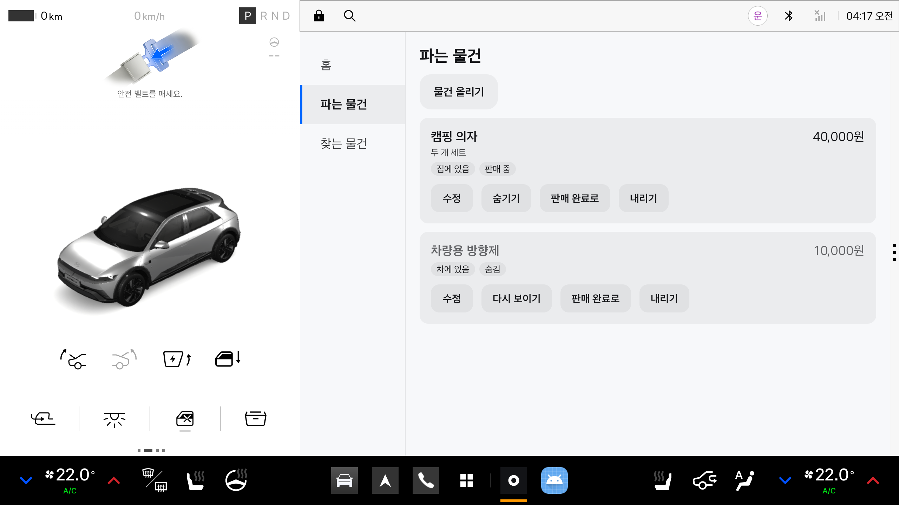

말로 올리면 바로 줄이 생겨요. 「주니어 카시트」 30,000원, 설명 "등받이 분리돼", "차에 있음", "판매 중"이 보여요.


입력 창에서 칸을 누르면 키패드가 아래에 떠요. 「닫기」와 「올리기」 버튼은 키패드 위에 그대로 보여요.
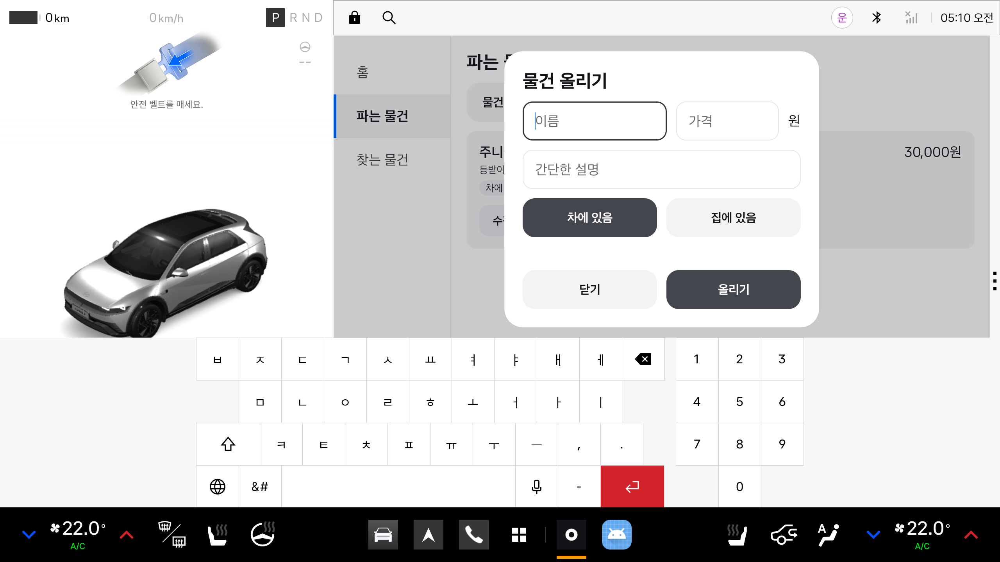

3. 「수정」을 누르면 「물건 수정」 창이 열려요. 이름, 가격, 설명, 위치를 고치고 「저장」을 눌러요. 「집에 있음」을 고르면 "집: 수정구"처럼 집이 있는 구가 보여요. (S-44, S-41)
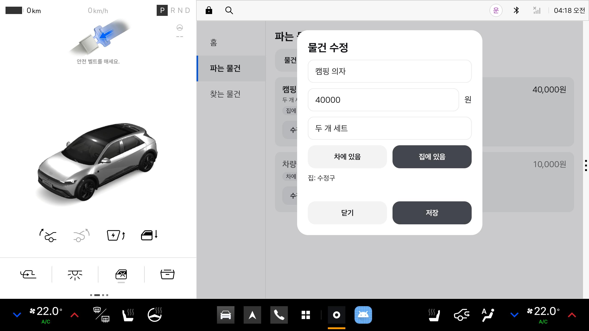

4. 폰에서도 물건을 올려요. 설명을 쓰고, 위치를 고르고, 「사진 넣기」「캡처로 채우기」「링크로 채우기」 가운데 하나로 채울 수 있어요. 집 물건이면 "집 물건을 올리려면 집 위치를 한 번 넣어 주세요. 구 이름까지만 남에게 보여요."라고 안내해요. (P-03, P-05, P-09, P-20, P-21)
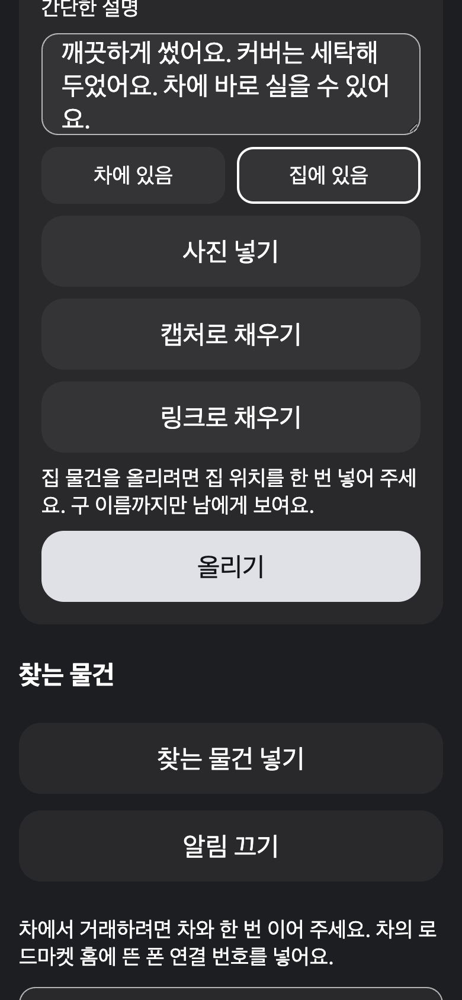

5. 폰의 「파는 물건」에서도 같은 줄과 버튼으로 관리해요. 숨긴 물건은 「다시 보이기」, 판매 완료로 바꾼 물건은 「다시 판매 중으로」가 보여요. (P-22)
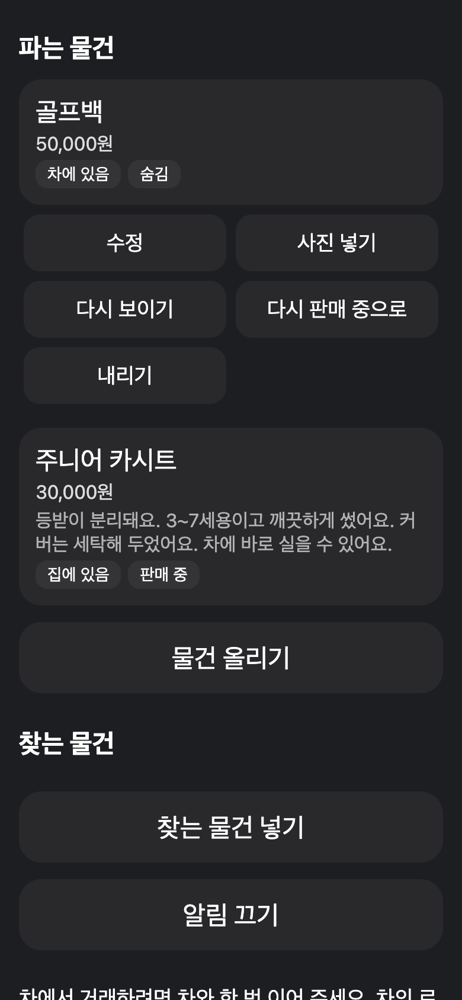

### 폰과 차 잇기

1. 폰에서 카카오로 로그인해요. (P-02)
2. 차 화면 홈에 "폰 연결 번호"가 떠요. 이 번호를 폰에 넣고 「차와 잇기」를 눌러요. 차에서 거래를 처음 쓸 때 한 번만 해요. (P-10)
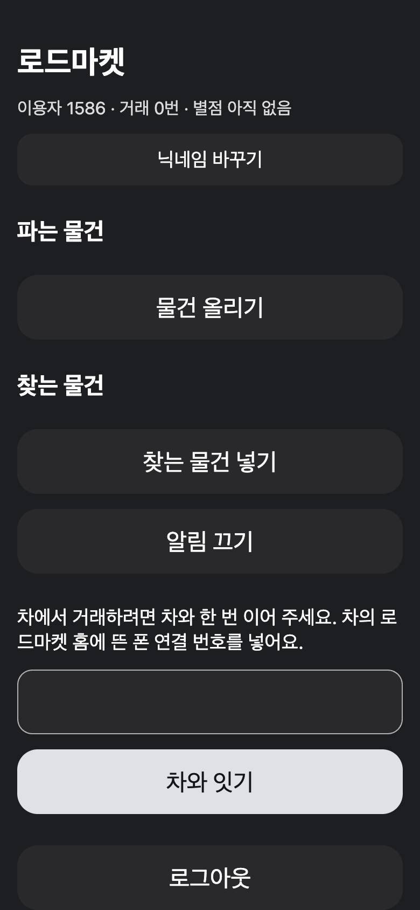

3. 번호 칸 아래의 번호판 칸에 차 번호판을 넣어요. 안 넣어도 돼요. 만날 때 상대에게는 뒤 네 자리만 보여요. (P-30)
4. 이으면 폰에 "차와 이어져 있어요. 번호 끝 3456"과 「번호판 바꾸기」가 보여요. (P-31)
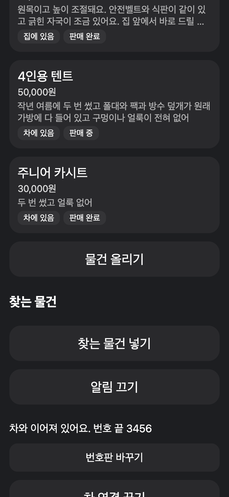
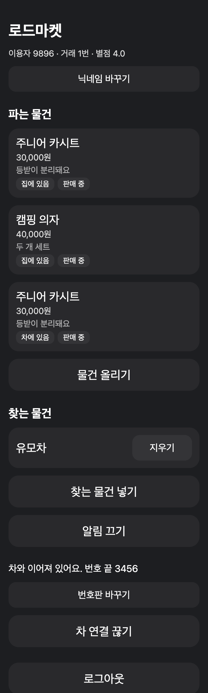

### 발견

1. 사는 사람이 차 화면 홈에서 「주변 물건 보기」를 눌러요. 내가 찾는 물건과 상관없이 주변 물건이 가까운 순으로 나와요. (B-62, B-64)
2. 줄마다 이름, 가격, 위치 배지, 판매자 줄이 있어요. 차에 있는 물건은 "4분 거리"처럼 분이 보이고, 집에 있는 물건은 "수정구"처럼 구 이름만 보여요. 집 물건 줄에는 "판매자가 폰으로 답해요."가 붙어요. 판매자 줄은 "이용자 2004 · 거래 5번 · 별점 아직 없음"처럼 보여요. (B-62, B-68, C-30, C-31)
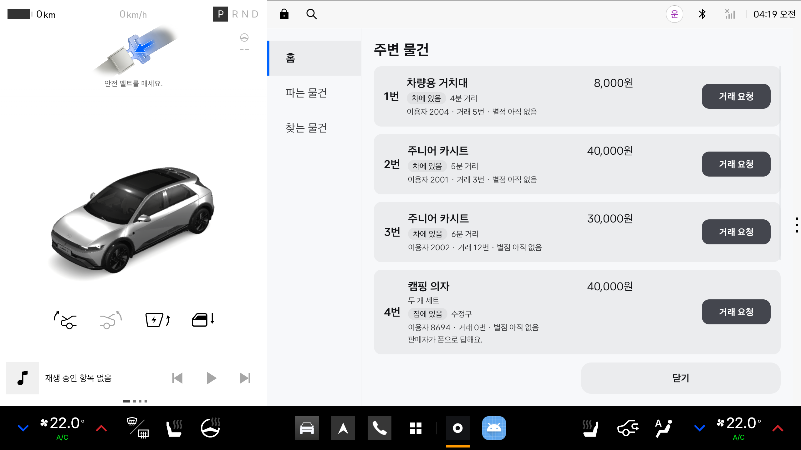

3. 달리는 중에는 가장 가까운 세 개만 크게 보여요. (B-63)
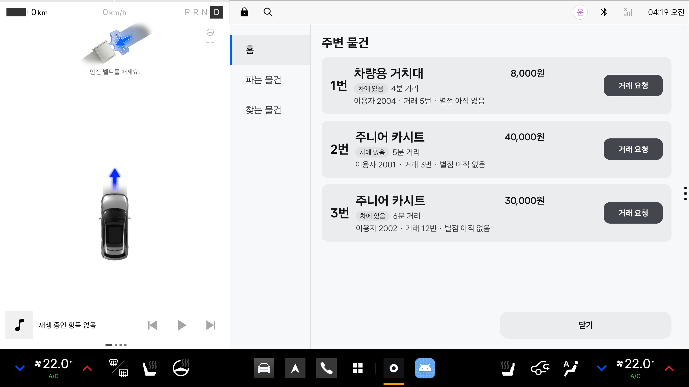

새로 찍은 사진이에요. 주니어 카시트 한 줄에 "차에 있음", "6분 거리", 판매자 줄이 보여요. 기어를 D로 하면 글자가 더 커져요.
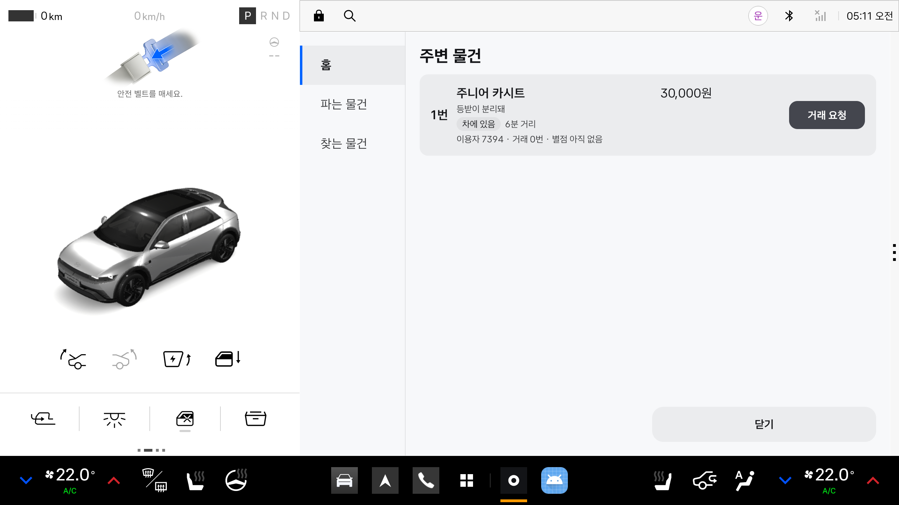
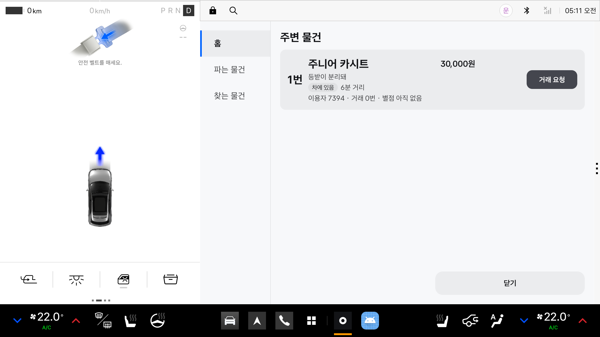

4. 말로도 물어요. "글레오, 로드마켓 앱으로 주변에 카시트 있어?"라고 하면 이름이나 설명에 "카시트"가 든 물건을 찾아요. (B-66, B-60)

### 성사와 만남

1. 사는 사람이 줄의 「거래 요청」을 눌러요. 또는 "글레오, 로드마켓 앱으로 1번 구매 요청 보내 줘"라고 말해요. 값은 올린 그대로예요. (B-40)
2. 파는 사람 차 화면에 「거래 요청」 화면이 떠요. 물건 이름과 가격, 「거절」「수락」이 보여요. 1분 안에 답하지 않으면 요청이 사라지고 사는 쪽 줄은 "응답 없음"이 돼요. (S-20, S-22, S-24, B-46)
구매자 줄은 "이용자 7460 · 별점 아직 없음 · 6분 거리"처럼 보여요.
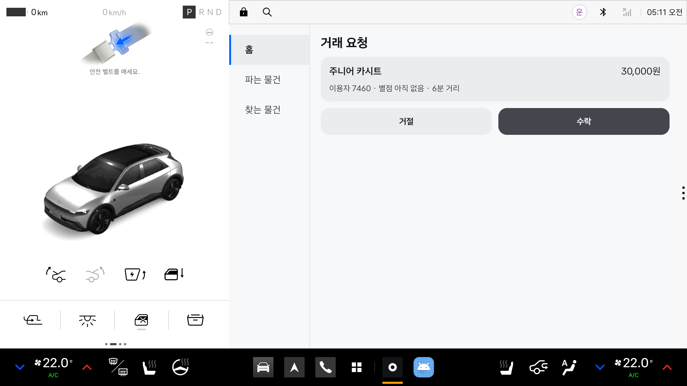
3. 수락한 판매자 가운데 사는 사람이 한 명을 고르면 거래가 정해져요. (M-01)
4. 거래가 정해지면 만날 곳 화면이 열려요. 장소 이름 아래에 "내가 몇 분 뒤 도착", 그 아래에 "상대는 몇 분 뒤 도착해요."가 보이고, 지도에 "만날 곳", "나", "상대"가 표시돼요. 아래에 「거래 취소」와 「만났어요」가 있어요. (M-30, M-31)
수락하면 두 차에 먼저 「가까운 곳으로 정하기」가 떠요.
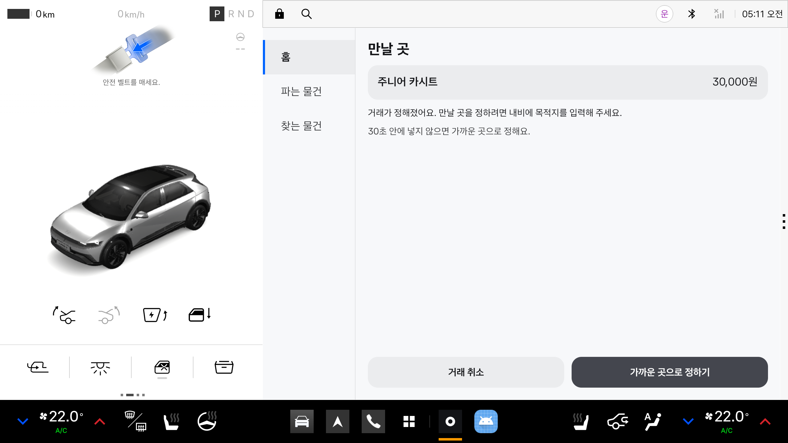

누르면 장소 이름, "3분 뒤 도착", "상대는 5분 뒤 도착해요.", 카카오 지도의 "만날 곳"·"나"·"상대"가 보여요.

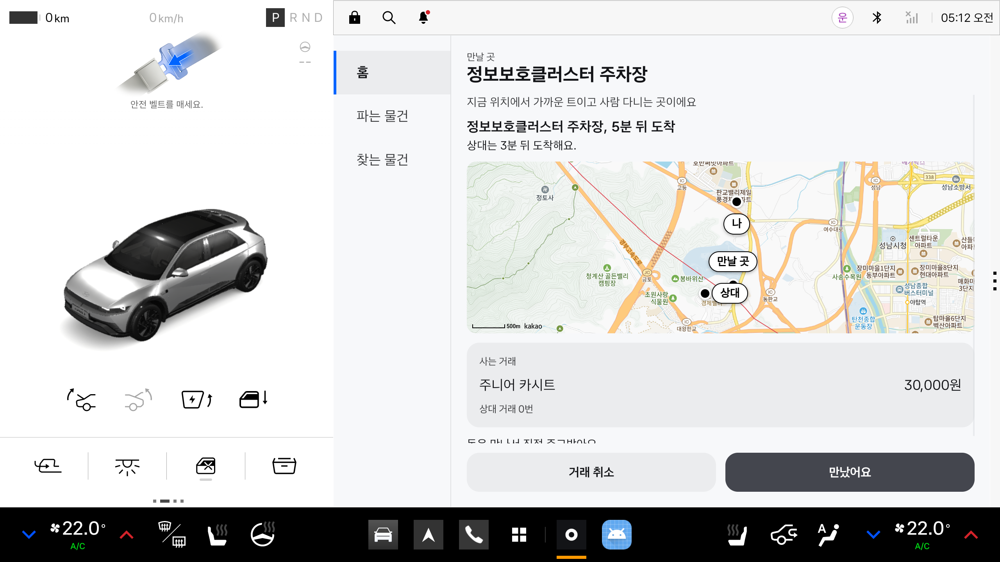

5. 만날 곳 화면에는 "상대 차: 번호 끝 3456"처럼 상대 차의 번호판 뒤 네 자리도 보여요. (M-32)

### 완료

1. 만난 뒤 차에서 내렸다가 다시 타면 차 화면에 「거래 어땠어요?」가 떠요. 물건 이름과 가격 아래에 "상대에게 별점을 주세요"와 0부터 5까지 여섯 칸이 있고, 「거래했어요」「안 했어요」「아직이에요」를 눌러요. 별점은 안 골라도 돼요. (M-08, M-33)
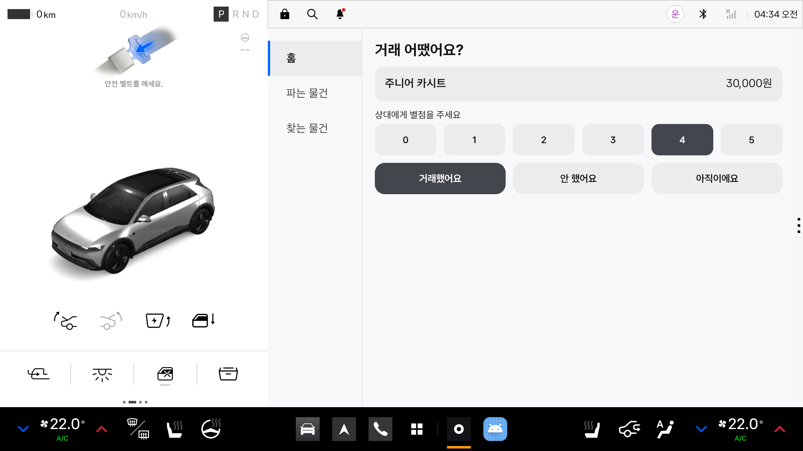
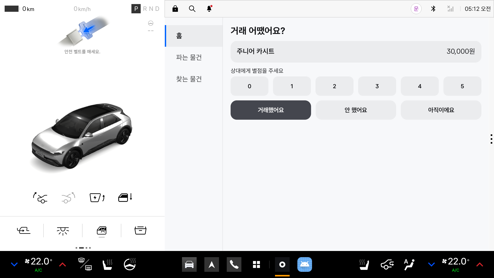
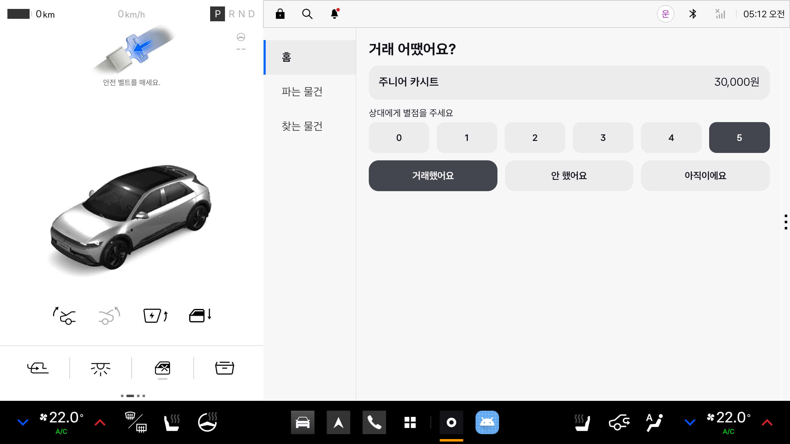

2. 차와 이어진 사람은 거래 중에 기어를 P로 두고 운전석 문을 열었다 닫으면 폰에도 "오늘 거래 어땠어요?" 카드가 떠요. 카드에 별점 0~5와 「거래했어요」「거래 못 했어요」가 있어요. (M-34, P-34, P-35)
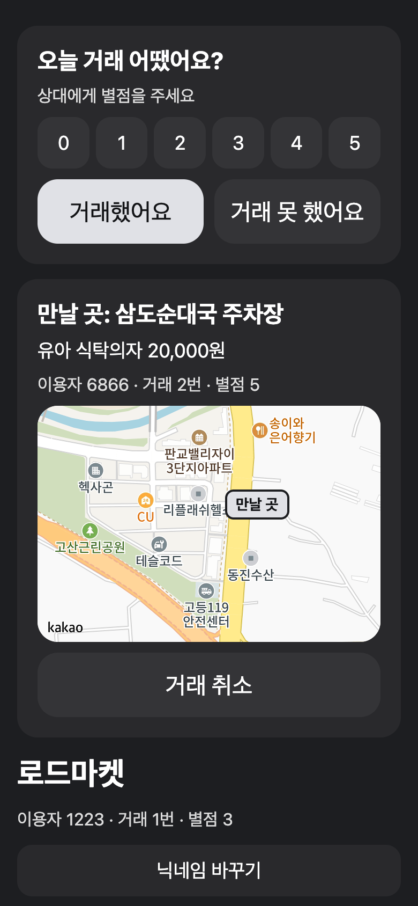
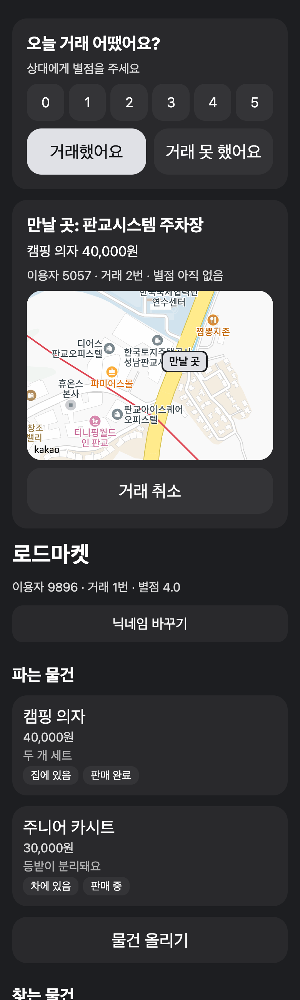

3. 한쪽이라도 「거래했어요」를 누르면 물건은 목록에서 사라지지 않고 "판매 완료"로 남아요. 「다시 판매 중으로」로 되돌릴 수 있어요. 둘 다 「거래 못 했어요」면 다시 "판매 중"이에요. (M-35, S-47)
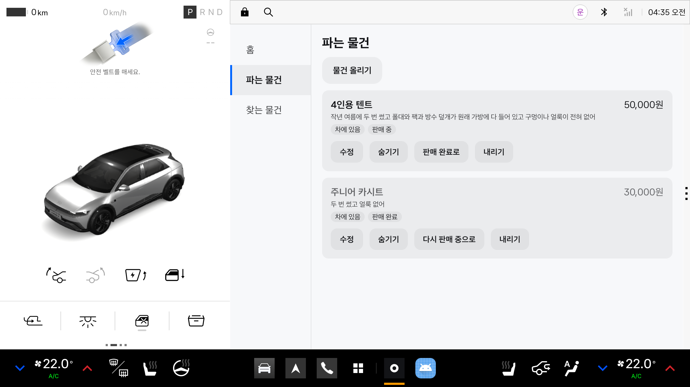
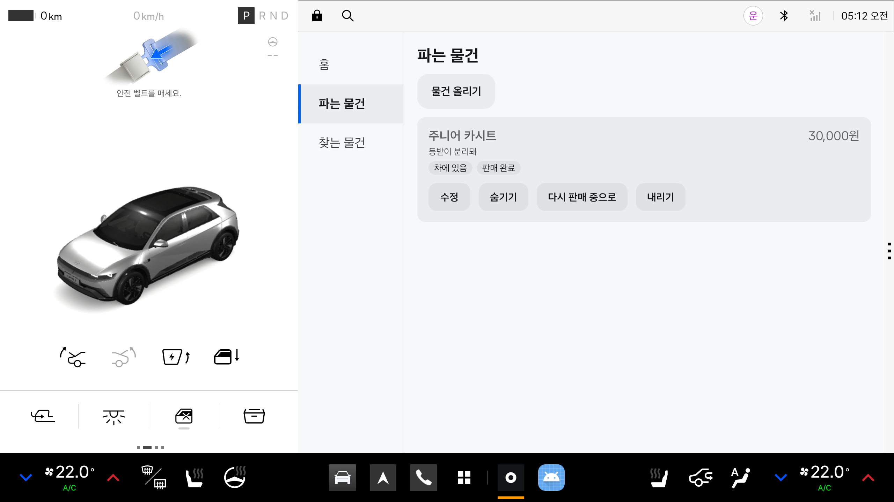

사는 차 홈에는 "방금: 거래를 마쳤어요."와 "내 거래 1번"이 보여요.


4. 받은 별점은 상대의 판매자 줄에 평균으로 쌓여요. 없으면 "별점 아직 없음"이에요. (C-31, C-40)

### 집 물건

1. 판매자가 폰에서 위치를 「집에 있음」으로 올려요. 집 위치는 한 번만 넣어요. 남에게는 구 이름까지만 보여요. (S-41, P-21; 사진은 위 「등록」의 폰 올리기)
2. 사는 사람 차 화면 주변 물건에 "집에 있음 · 수정구"와 "판매자가 폰으로 답해요."가 보여요. 「거래 요청」을 누르면 줄이 "답 기다리는 중"으로 바뀌어요. (B-68)
3. 요청은 판매자 차가 아니라 판매자 폰으로 가요. 폰에 "요청이 왔어요" 카드와 「수락」「거절」이 떠요. 3분 안에 답하지 않으면 사라져요. (S-50, P-25)
4. 수락하면 목적지를 묻지 않고 만날 곳이 바로 정해져요. 판매자 집 근처의 편의점, 주차장, 주유소 가운데 구매자 차가 가장 덜 돌아가는 곳이에요. 판매자 폰 카드에 "만날 곳: 장소 이름"과 「거래 취소」가 보여요. (M-36, B-69, S-51, P-25)
5. 판매자 폰 카드에 "구매자가 몇 분 뒤 도착해요."가 보이고, 그 아래 지도에 "만날 곳"과 "구매자"가 표시돼요. (P-32, P-33)
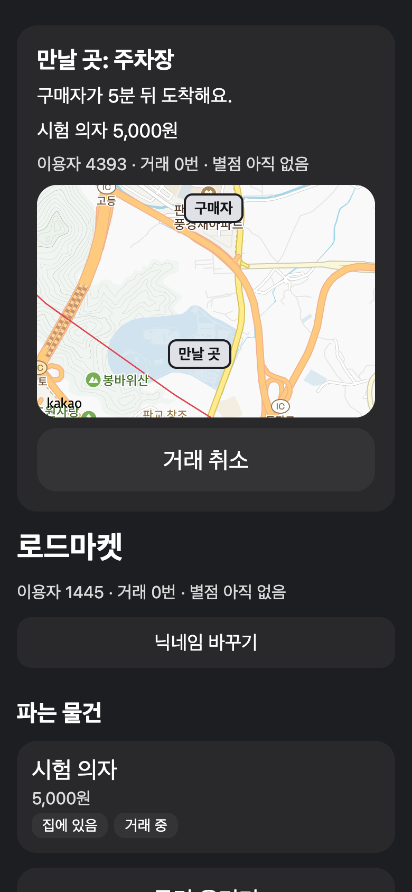
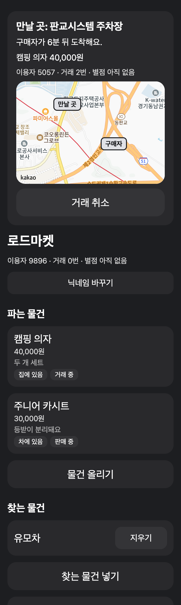

6. 구매자가 거래를 마치면 판매자 폰에도 "오늘 거래 어땠어요?" 카드가 떠요. (P-35, P-34)

### 급구

1. 사는 사람이 「급구 올리기」를 눌러 물건 이름과 "원하는 물건의 특징"을 넣어요. 달리는 중에는 "글레오, 로드마켓 앱으로 유아용 카시트 급구 올려 줘"처럼 말로만 해요. 올라가면 "급구 올리는 중 · 유아용 카시트"와 「급구 내리기」가 보여요. (U-01, U-02)
2. 급구 범위에 새로 들어온 차에는 앱 목소리로 "주변에서 유아용 카시트를 급하게 찾는 분이 있어요."라고 알리고, 홈에 「판매하기」「닫기」가 있는 카드가 떠요. (U-04, U-05)
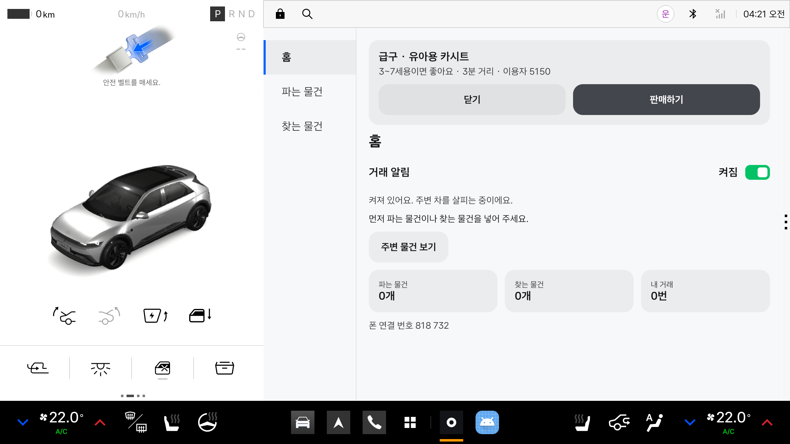
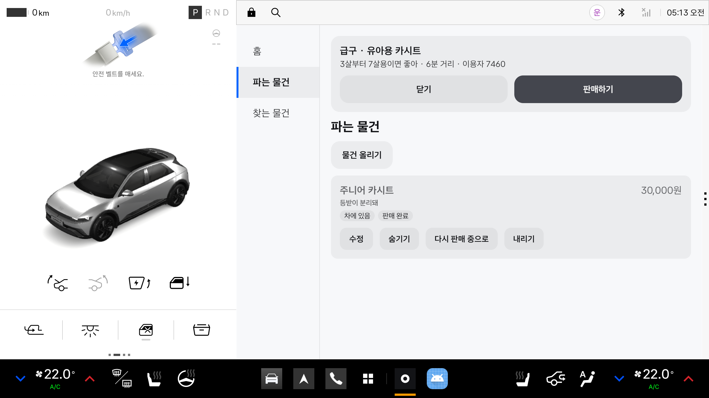
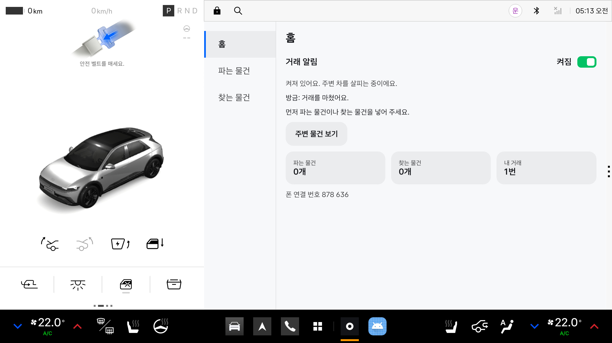

3. 서 있을 때 「판매하기」를 누르면 상품명, 간단한 설명, 값을 넣는 창이 열려요. 값 대신 「나눔」도 고를 수 있어요. (U-06)
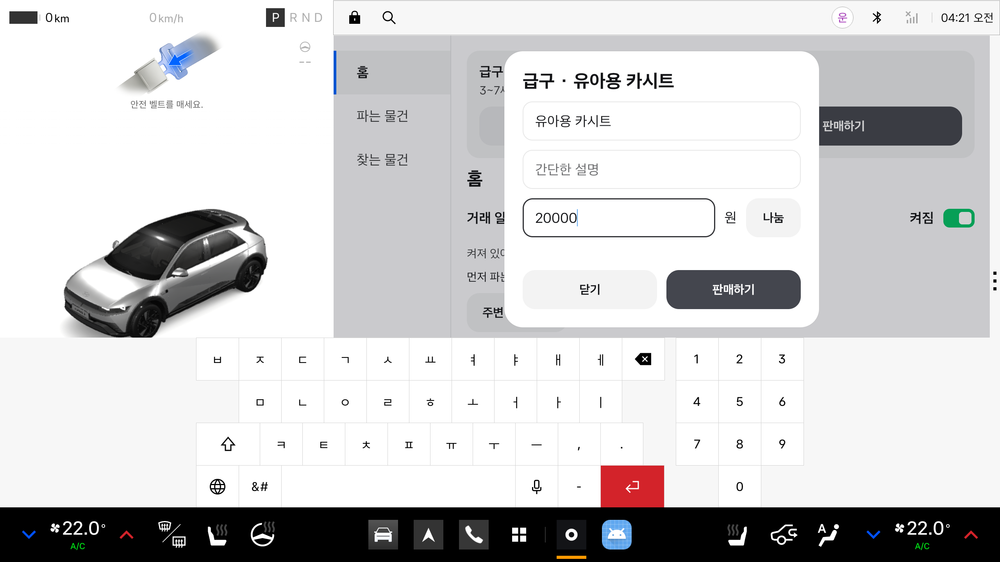
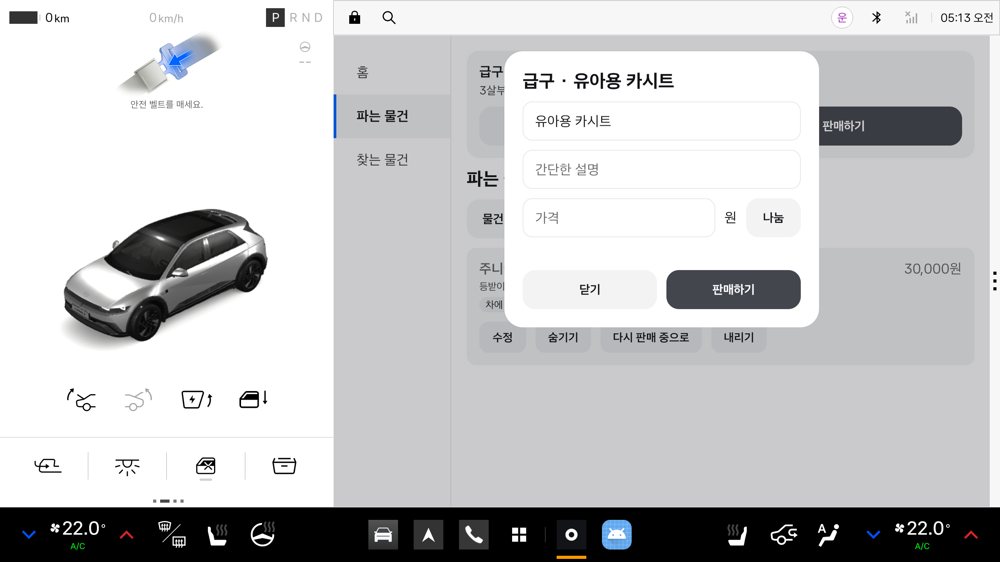

4. 달리는 중에는 입력 창이 열리지 않고, 카드에 말로 답하라는 안내가 떠요. 사진의 안내는 「달리는 중에는 말로 답해요.」와 글레오에게 "급구에 카시트 2만 원에 판매해 줘"라고 하는 예시예요. (U-06)
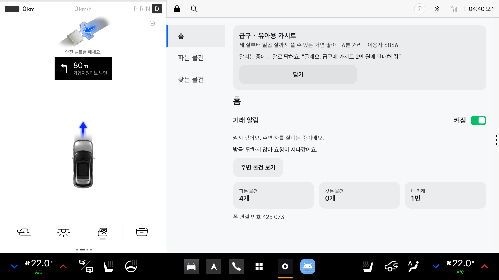

5. 올린 사람에게 답이 오면 그중 하나를 골라요. 고르면 보통 거래처럼 만날 곳으로 이어져요. 「나눔」으로 답하면 답 줄의 값이 "나눔"으로 보여요. 판매자 줄은 "3분 거리 · 이용자 7394 · 거래 1번 · 별점 5.0"이에요. (U-07, U-08, M-01)
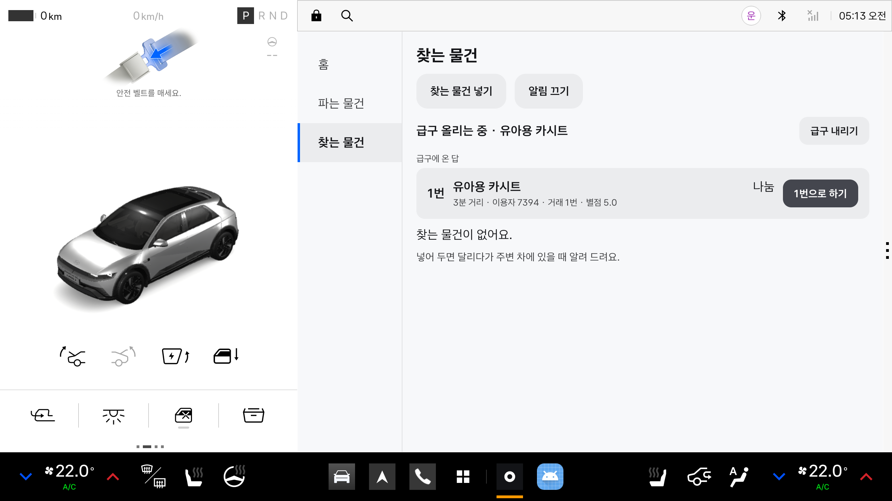

「1번으로 하기」를 누르면 값 "나눔"으로 거래가 정해지고, 만날 곳은 "사는 거래 · 유아용 카시트 · 나눔"으로 보여요.
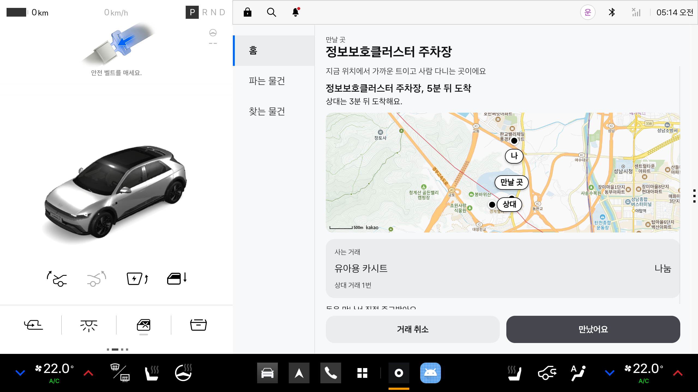

6. 급구는 내리거나, 거래 알림을 끄거나, 거래가 정해지면 끝나요. (U-03, U-09)

### 경로 추천

1. 거래 알림이 켜져 있을 때 내비에 목적지를 넣으면, 내 찾는 물건이나 파는 물건과 맞는 길이 있을 때 알림이 한 번 떠요. 사진에는 "카시트 판매자가 많은 길이 있어요. 1분 더 걸려요. 이 길로 갈까요?"와 「괜찮아요」「이 길로 가기」가 보여요. (R-01)
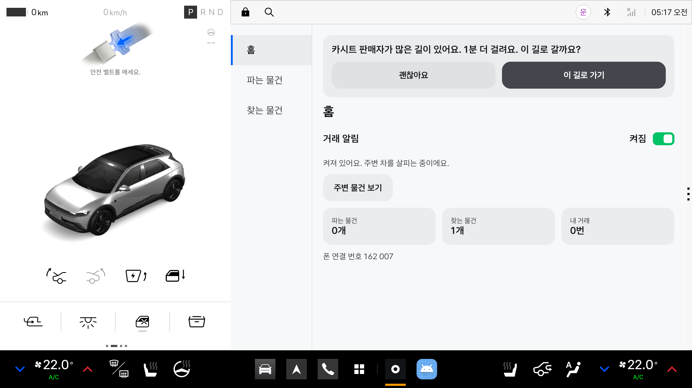

「이 길로 가기」를 누르면 앱이 내비에 경유지를 넣어요. 내비 아래 카드에 경유지 이름이 보여요.

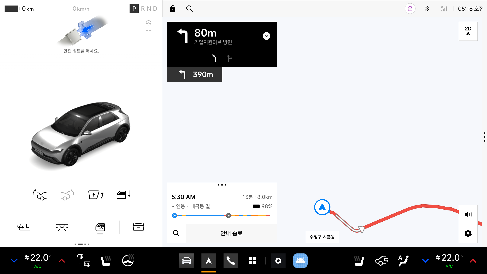

이 사진의 "1분 더"는 서버를 켠 뒤 처음 계산한 어림값이에요. 길을 따라 다시 재면 6분쯤이에요.

2. 「이 길로 가기」를 누르면 내비에 그 길의 경유지가 들어가요. 원래 목적지는 그대로예요. 「괜찮아요」를 누르면 알림만 사라지고 내비는 그대로예요. "글레오, 로드마켓 앱으로 이 길로 가자"처럼 말해도 돼요. (R-02, R-03)
3. 맞는 길이 없거나 거래 중이면 알림이 안 떠요. 말도 하지 않아요. (R-04, C-42)
4. 드라이브 코스는 말했을 때만 떠요. "글레오, 로드마켓 앱으로 드라이브 코스 추천해 줘"라고 하면 가까운 시연용 코스 하나를 같은 두 버튼으로 알려요. 맞는 코스가 없으면 글레오가 "지금은 추천할 코스가 없어요."라고 해요. (R-05)

---

아래부터는 버튼 모양과 일부 문구가 바뀌기 전에 찍은 사진이에요. 흐름은 같아요.

## 두 대로 본 거래 한 번

에뮬레이터 두 대가 서버를 거쳐 진짜로 거래를 주고받은 기록이에요.
A는 파는 차(흰색 SUV, 번호 끝 1204), B는 사는 차(검은색 세단, 번호 끝 7788)예요.
두 차는 1~2km쯤 떨어져 있고, A에만 내비 목적지가 있어요.

1. A가 말로 물건을 올렸어요. B는 말로 찾는 물건을 넣었어요. A의 「파는 물건」에는 "차량용 방향제 10,000원"이, B의 「찾는 물건」에는 "차량용 방향제"가 생겼어요. (S-01, B-08)
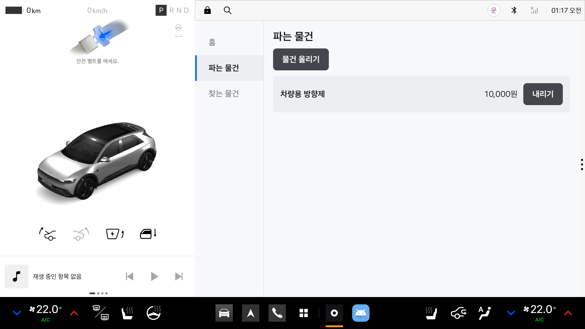
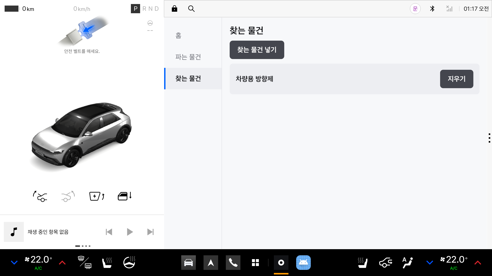

2. A가 홈에서 「거래 알림」을 켰어요. B도 켰어요. (C-04)


3. B에 「주변 물건」 화면이 떴어요. 진짜 A의 물건이에요. "3분 거리"와 "상대 거래 0번"이 보여요. (B-20, S-20)


4. B가 「요청 보내기」를 눌렀어요. B의 줄은 "답 기다리는 중"이 됐어요. A에는 「거래 요청」 화면이 떴어요. (B-40, S-20)


5. A가 「수락」을 눌렀어요. 거래가 정해졌어요. B의 줄에는 고를 것이 하나뿐이라 바로 정해졌어요. A에는 "상대가 목적지를 넣는 중이에요."가 보여요. B에는 목적지를 묻는 화면이 떴어요. B에는 목적지가 없기 때문이에요. (B-44, M-21, M-02)
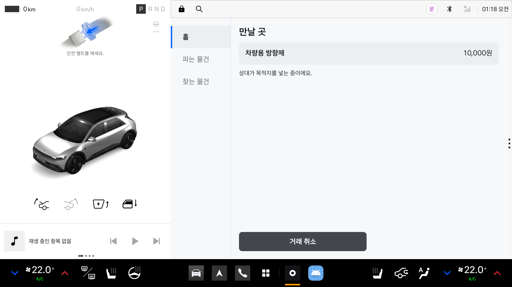


6. B가 「가까운 곳으로 정하기」를 눌렀어요. 서버가 만날 곳을 "GS25 고등호반써밋점"으로 골랐어요. 두 차의 내비가 앞으로 나오며 같은 장소가 들어갔어요. (M-04, M-20)
앱 목소리, A: "거래가 정해졌어요. 만날 곳은 GS25 고등호반써밋점이에요. 두 분 가는 길 사이의 트이고 사람 다니는 곳이에요. 내비에 넣었어요."
앱 목소리, B: "만날 곳은 GS25 고등호반써밋점이에요. 지금 위치에서 가까운 트이고 사람 다니는 곳이에요. 내비에 넣었어요."
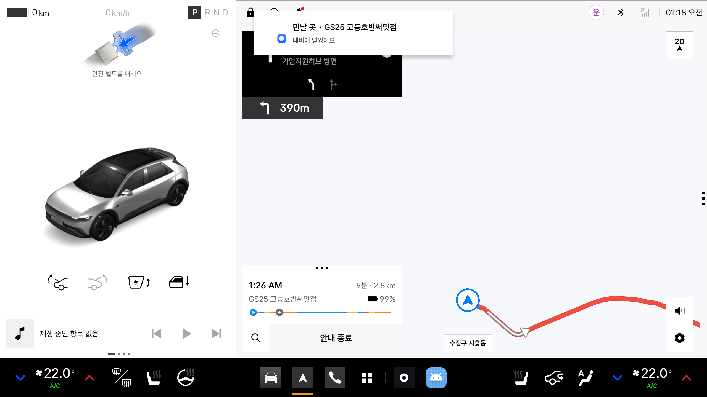
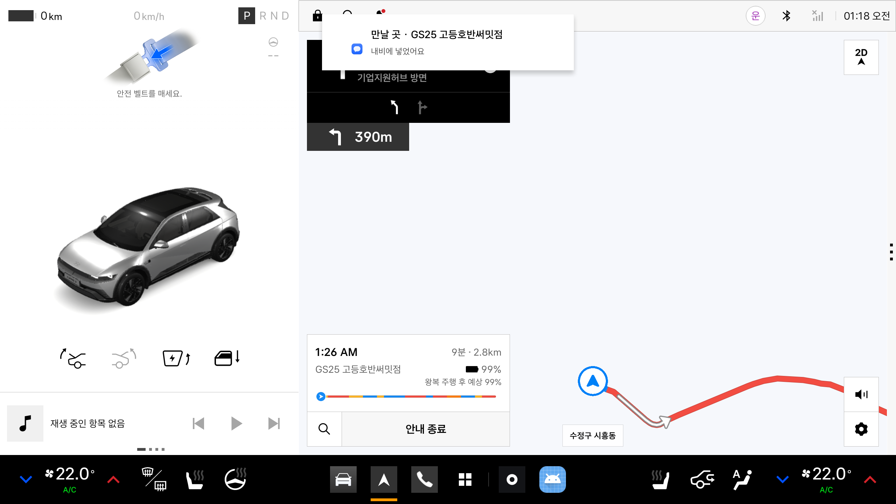

   로드마켓을 다시 열면 두 차 모두 「만날 곳」 화면이에요. 장소 이름이 같고, 서로의 차 정보가 보여요. A는 "상대 차: 검은색 세단 · 번호 끝 7788", B는 "상대 차: 흰색 SUV · 번호 끝 1204"예요. 한 줄 설명은 목적지가 있는 A는 "두 분 가는 길 사이", 없는 B는 "지금 위치에서 가까운"이에요. (M-06, M-04)


7. B에서 기어 P인 채로 운전석 문을 두 번 열었다 닫았어요. B에 「거래 어땠어요?」가 떴어요. A는 「만났어요」를 눌러 같은 화면이 됐어요. (M-08, M-09)


   두 차 모두 「거래했어요」를 눌렀어요. 내비에서 만날 곳이 지워졌고, 홈에 "방금: 거래를 마쳤어요."와 "내 거래 1번"이 보여요. A의 파는 물건은 내려갔어요. (M-10, M-13)


8. 어긋나는 경우를 두 가지 봤어요.
   (가) A가 「거절」을 눌렀어요. B의 줄이 "거절함"으로 바뀌었어요. 앱 목소리, B: "1번은 거절했어요." (B-45)
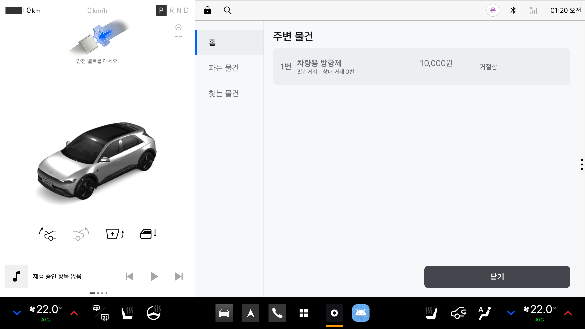

   (나) 거래가 정해진 뒤 A가 「거래 취소」를 누르고, 확인 창에서 한 번 더 「거래 취소」를 눌렀어요. B에 "방금: 상대가 거래를 취소했어요."가 떴고, 내비에서 만날 곳이 지워졌어요. 앱 목소리, B: "상대가 거래를 취소했어요. 내비에서 만날 곳을 지웠어요." (M-15, M-16)


---

## 폰과 사진, 길 따라 잰 거리

폰 화면으로 물건을 올리고, 사진이 차에 보이는 모습을 두 대로 본 기록이에요.
A는 파는 차(흰색 SUV, 번호 끝 1204), B는 사는 차(검은색 세단, 번호 끝 7788)예요. 두 차는 기어 P이고, 거래 알림이 켜져 있어요.
A는 37.4127, 127.0947에, B는 37.4250, 127.1000에 있어요. 두 차 모두 내비 목적지가 없어요.
폰에서 올린 사진은 이 시험을 위해 만든 초록색 그림이에요.

1. A의 홈 맨 아래에 "폰 연결 번호 459 855"가 보여요. 폰 화면에 이 번호를 넣으면 A와 이어져요. (C-23)


2. 폰 화면을 열었어요. 처음 화면에는 제목과 소개 한 줄, 번호 칸, 「차와 잇기」가 있어요. 번호를 넣고 이으면 「파는 물건」과 「찾는 물건」 목록이 나와요. (P-02)
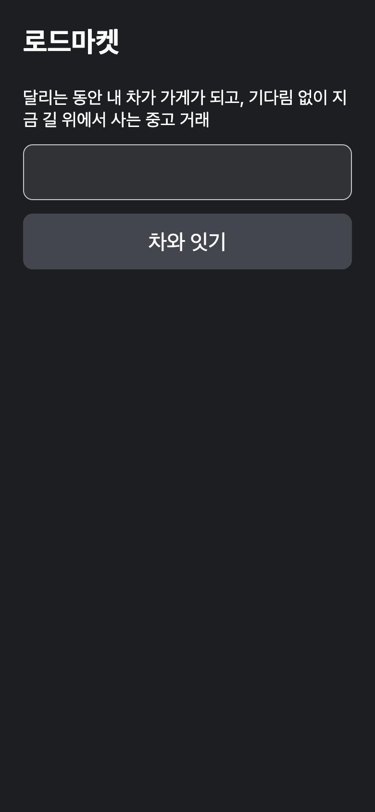
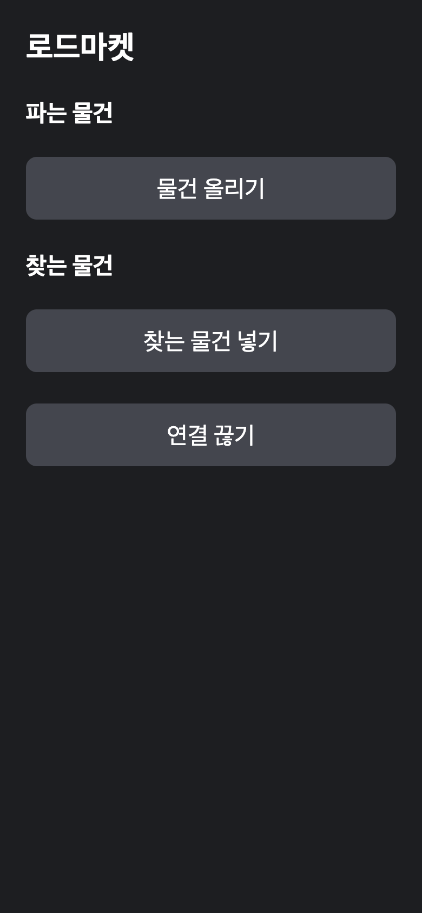

3. 폰에서 「물건 올리기」를 눌렀어요. 이름 "차량용 방향제", 가격 10000을 넣고 사진을 골랐어요. 사진이 칸 안에 작게 보여요. 「올리기」를 누르자 폰 목록에 사진과 함께 "차량용 방향제 10,000원"이 생겼어요. (P-03)
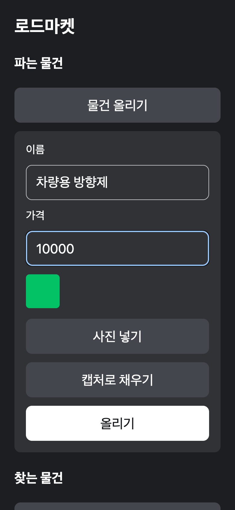
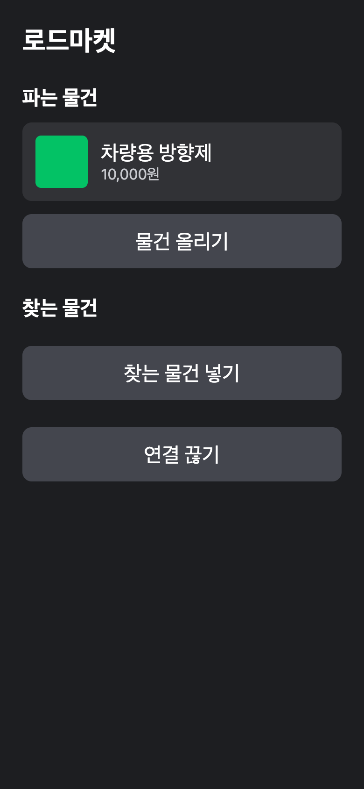

4. A의 「파는 물건」에 같은 물건이 사진과 함께 생겼어요. 폰에서 올린 것이 차에 온 거예요. (C-24)
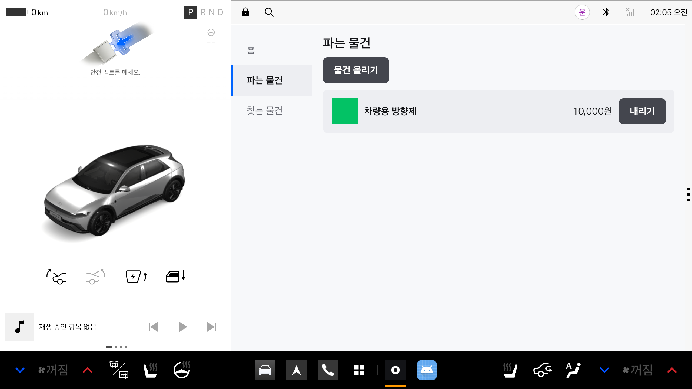

5. B의 연결 번호로 폰을 이어서 찾는 물건 "차량용 방향제"를 넣었어요. B의 「주변 물건」에 A의 물건이 사진과 함께 떴어요. "6분 거리"와 "상대 거래 0번"이 보여요. (P-06, B-30, D-15)
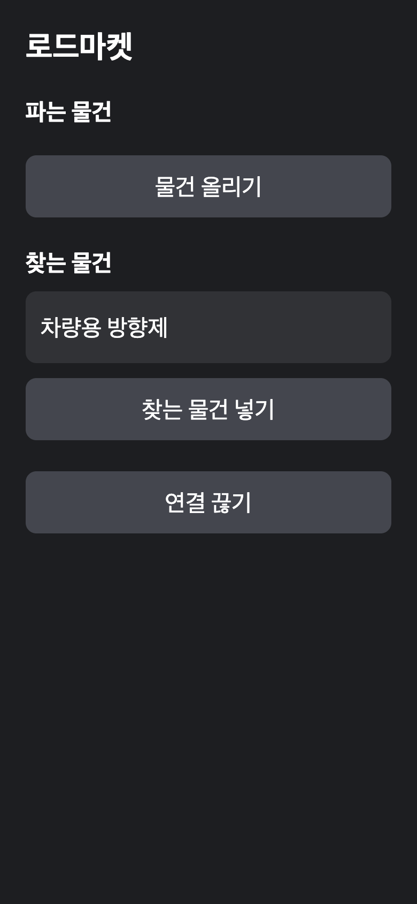
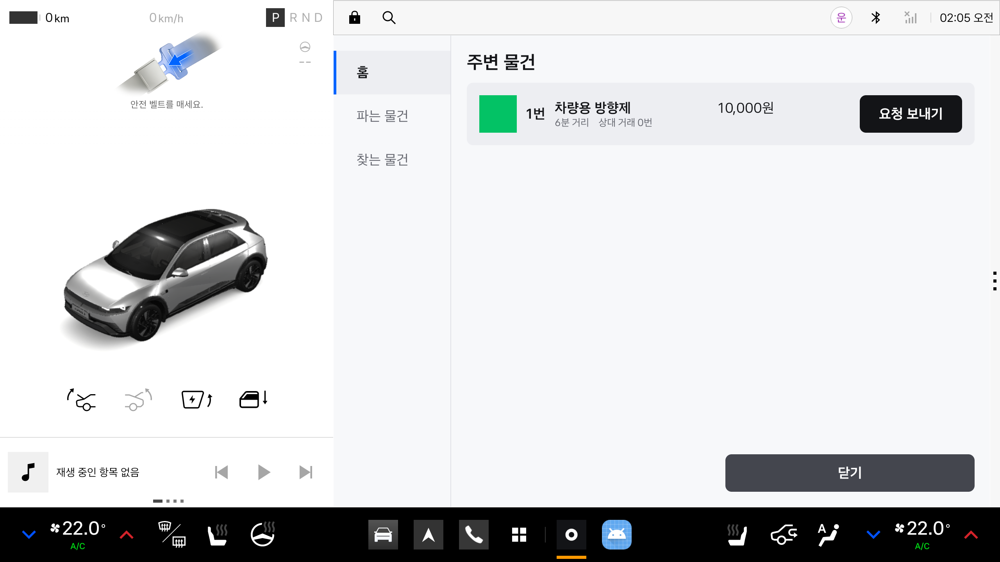

   이 "6분"은 길을 따라 잰 값이에요. 서버 기록에 B에서 A까지 길 따라 359초(약 6분)가 남아 있어요. 올림하면 6분이에요. 직선거리로 낸 값이 아니에요.

6. B가 「요청 보내기」를 눌렀어요. A의 「거래 요청」 화면에 물건 사진이 보여요. "6분 거리"와 「거절」 「수락」도 보여요. (B-40, S-20, B-30)
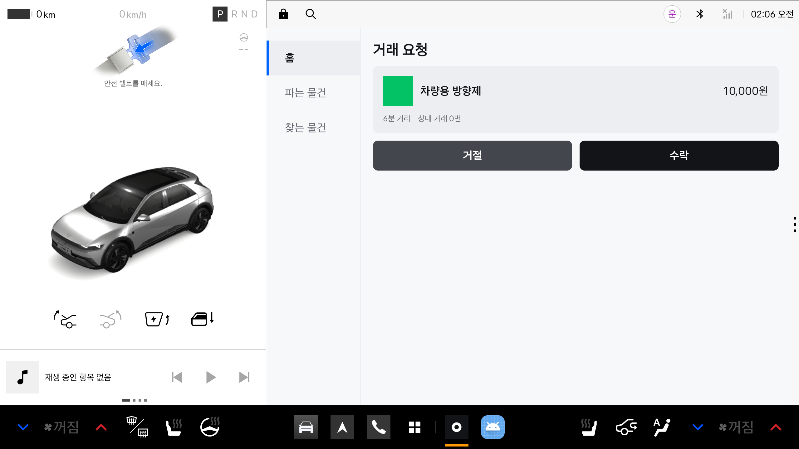
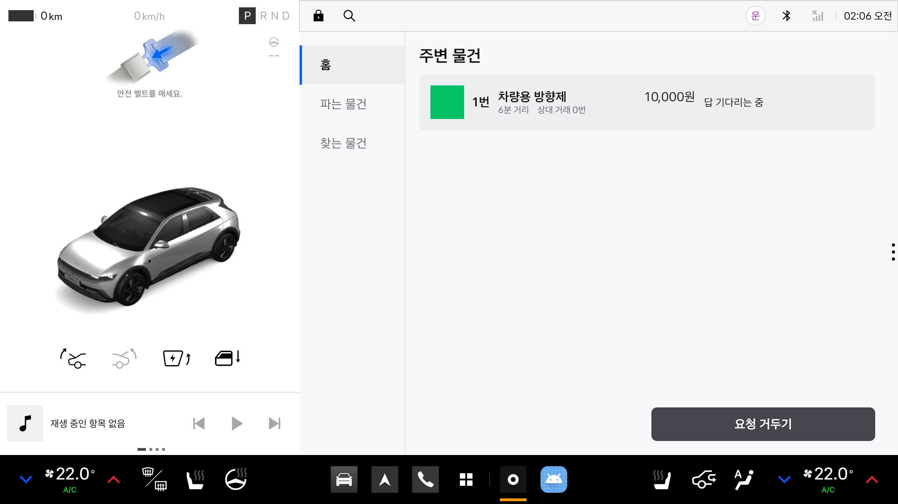

7. "다른 거래 중"은 6번 앞에 따로 확인했어요. B의 주변 물건 목록이 떠 있을 때, 가짜 사는 차가 A에 요청을 보냈어요. 그러자 B의 줄이 "다른 거래 중"으로 바뀌었어요. 「요청 보내기」가 사라지고 글자가 흐려요. A에는 가짜 사는 차의 요청이 떴어요. 앱은 말하지 않았어요. (B-56)
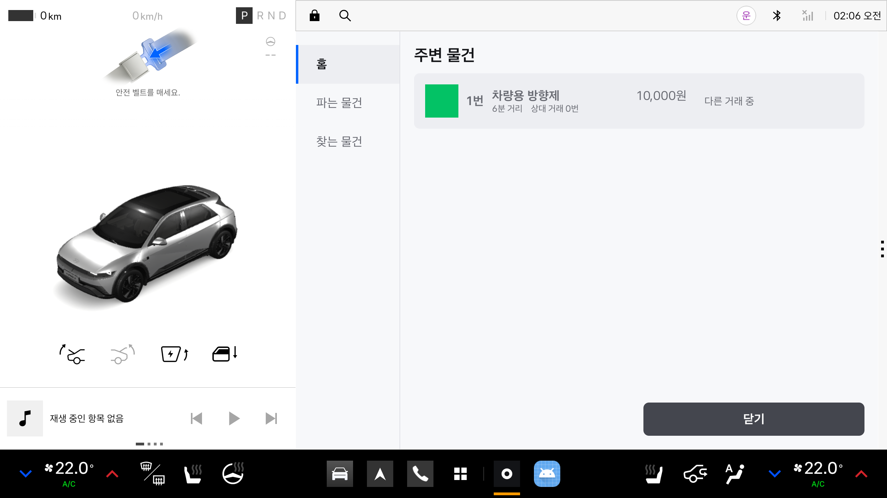


   그 뒤 가짜 사는 차가 요청을 거뒀어요. B의 줄은 저절로 되살아나지 않았어요. 6번을 하려고 B의 목록을 닫고 「거래 알림」을 껐다 켰더니 목록이 다시 떴어요.

8. A가 「수락」을 눌렀어요. 두 차 모두 "목적지를 입력해 주세요" 화면이 떴어요. 두 차 모두 「가까운 곳으로 정하기」를 눌렀어요. (S-20, M-20)
   두 차에 같은 만날 곳 "정보보호클러스터 주차장"이 정해졌어요. A에는 "상대 차: 검은색 세단 · 번호 끝 7788"이, B에는 "상대 차: 흰색 SUV · 번호 끝 1204"가 보여요. 서버 기록에 "길찾기 5곳 다시 계산"이 남아 있어요. 후보 다섯 곳을 길을 따라 다시 쟀다는 뜻이에요. (M-20)


---

## 인터넷 서버로 본 한 번

위의 두 대 거래는 맥에서 돌린 서버로 찍었어요. 같은 서버를 인터넷(Railway)에 올리고, 그 서버를 보는 앱으로 한 번 더 해 봤어요.

1. 사는 차에 주변 물건이 떴어요. 파는 차가 올린 "차량용 방향제"예요. (B-20)


2. 사는 차가 「요청 보내기」를 누르자 파는 차에 거래 요청이 왔어요. (S-20)


3. 파는 차가 수락하고 사는 차가 「가까운 곳으로 정하기」를 누르자, 두 차에 같은 만날 곳 "GS25 고등호반써밋점"이 정해졌어요. 파는 차 화면에 상대 차 정보가 보여요. (M-06, M-20)


---

## 먼저 보는 두 흐름

아래 두 흐름은 한 대와 서버 안의 가짜 차로 찍은 것이에요.

번호순으로 보기 전에, 한 번의 거래가 처음부터 끝까지 어떻게 흘러가는지 먼저 보여 드려요.
같은 내용이 영상 두 편에도 담겨 있어요. 자세한 설명은 뒤의 번호별 항목에 있어요.

### 사는 사람의 한 번

1. 홈에서 「거래 알림」을 켰어요. (C-04)


2. 주변 차에 찾던 물건이 있어서 「주변 물건」 화면이 떴어요. (B-20)


3. 「모두 보내기」를 눌렀어요. 줄마다 "답 기다리는 중"이 됐어요. (B-41)


4. 답이 왔어요. 1번은 거절했고, 2번과 3번은 수락했어요. (B-43, B-45)


5. 「2번으로 하기」를 눌렀어요. 거래가 정해지고, 앱이 내비에 만날 곳을 경유지로 넣었어요. 내비가 스스로 앞으로 나왔어요. 길 목록 위에 "경유지 1개 포함"이 보여요. (B-49, M-03)


6. 로드마켓을 다시 열면 「만날 곳」 화면이에요. (M-06)


7. 기어 P에서 운전석 문을 두 번 열었다 닫았어요. 내렸다가 다시 탄 것이에요. 「거래 어땠어요?」가 떴어요. (M-08)


8. 「거래했어요」를 눌렀어요. 앱이 내비에서 만날 곳을 지웠어요. 내비가 다시 앞으로 나왔고, 길은 원래 목적지로 가는 길만 남았어요. (M-10, M-13)


### 파는 사람의 한 번

1. 달리는 중에 내 물건을 사겠다는 요청이 왔어요. (S-20)


2. 「수락」을 눌렀어요. 상대가 고르기를 기다려요. (S-22)


3. 상대가 나를 골랐어요. 거래가 정해지고 「만날 곳」 화면이 됐어요. (S-25, M-06)


4. 「만났어요」를 눌렀어요. 「거래 어땠어요?」가 떴어요. (M-09)


5. 「거래했어요」를 누른 뒤의 홈이에요. "내 거래" 숫자가 늘었고, "방금: 거래를 마쳤어요."가 보여요. (M-10, C-22)


---

## 공통 (C)

### C-01, C-21, C-11 앱을 처음 열었을 때
한 일: 앱을 처음 상태로 되돌리고 로드마켓을 열었어요.
일어난 일: 홈이 열려요. "거래 알림" 스위치는 꺼짐이고, 숫자는 파는 물건 0개, 찾는 물건 0개, 내 거래 0번이에요. "먼저 파는 물건이나 찾는 물건을 넣어 주세요."가 보여요.


### C-02 왼쪽 메뉴
한 일: 메뉴 「홈」 「파는 물건」 「찾는 물건」을 차례로 눌렀어요. 주변 물건 목록이 떠 있는 중에도 눌러 봤어요.
일어난 일: 누른 메뉴가 밝게 바뀌고 그 화면이 보여요. 주변 물건 중에 「파는 물건」을 눌러도 목록이 그대로 보여요.


### C-03 홈의 상태 줄
한 일: 꺼짐, 켜짐, 진행 중일 때 홈을 봤어요.
일어난 일: 꺼짐은 "꺼져 있어요. 켜면 달리는 동안 거래를 알려 드려요."예요. 켜짐은 "켜져 있어요. 주변 차를 살피는 중이에요."예요. 진행 중은 "켜져 있어요. 진행 중인 거래가 있어요."예요.


### C-04 거래 알림 켜기
한 일: 「거래 알림」 스위치를 눌렀어요.
일어난 일: 스위치가 초록색 "켜짐"으로 바뀌어요. 차 시스템에는 "로드마켓 거래 알림 켜짐" 상시 알림이 올라가요. 이 알림은 차의 알림 목록(종 모양)에는 보이지 않아요. 종 모양에는 만날 곳 알림처럼 다른 알림만 보여요. 요건표에도 이렇게 적혀 있어요.


### C-05 말로 켜기
한 일: 꺼진 상태에서 "로드마켓 앱으로 거래 알림 켜 줘"라고 말했어요. 한 번 더 말해 봤어요.
일어난 일: 스위치가 켜져요.

글레오: "거래 알림을 켰어요." 이미 켜져 있을 때는 "이미 켜져 있어요."

### C-06 거래 알림 끄기
한 일: 켜진 상태에서 스위치를 눌렀어요. 주변 물건 목록이 열려 있을 때도 한 번 눌렀어요.
일어난 일: "꺼짐"이 돼요. 상시 알림이 내려가요. 열려 있던 주변 물건 목록이 닫히고 홈이 보여요.


### C-07 말로 끄기
한 일: "로드마켓 앱으로 거래 알림 꺼 줘"라고 말했어요. 한 번 더 말해 봤어요.
일어난 일: "꺼짐"이 돼요.

글레오: "거래 알림을 껐어요." 이미 꺼져 있을 때는 "이미 꺼져 있어요."

### C-08 진행 중에 버튼으로 끄기
한 일: 거래 어땠어요?가 남은 상태에서 스위치를 눌렀어요. 「그대로 두기」도 눌러 보고, 「끄기」도 눌러 봤어요.
일어난 일: 확인 창에 "진행 중인 거래가 취소돼요. 끌까요?"가 떠요. 「그대로 두기」를 누르면 아무 일도 없어요. 「끄기」를 누른 결과는 C-16에 있어요.


### C-09 진행 중에 말로 끄기
한 일: 만날 곳이 정해진 거래 중에 "로드마켓 앱으로 거래 알림 꺼 줘"라고 말했어요.
일어난 일: 확인 창 없이 바로 꺼져요. 내비에 넣었던 만날 곳이 지워지고 내비가 앞으로 나와요.

글레오: "거래 알림을 껐어요. 진행 중이던 거래는 취소했어요."

### C-10 낮과 밤
한 일: 화면 모드를 밤으로 바꾸고 여러 화면을 찍었어요.
일어난 일: 바탕이 어두워지고 글자가 밝아져요. 가장 중요한 버튼은 흰 바탕에 어두운 글자예요.


### C-12 홈의 카드
한 일: 주변 물건 목록, 거래 요청, 만날 곳, 거래 어땠어요?가 있을 때 다른 화면에 갔다가 홈으로 와서 카드를 눌렀어요.
일어난 일: 카드는 한 번에 하나만 보여요. 검정 바탕이고 글은 "주변 물건 3개 · 보기", "거래 요청이 왔어요 · 보기", "만날 곳 · 보기", "거래 어땠어요? · 답하기" 중 하나예요. 누르면 그 화면이 열려요.


### C-13 기어를 못 읽을 때
사진 없음: 기어 값을 못 읽는 상태를 만드는 방법이 없어요.

### C-14 좁은 창
한 일: 화면 오른쪽 손잡이를 끌어 로드마켓을 왼쪽 반으로 줄였어요. 오른쪽에는 내비가 떠 있어요.
일어난 일: 왼쪽 메뉴가 위쪽 가로 줄 "홈 / 파는 물건 / 찾는 물건"으로 바뀌어요. 내용은 그 아래에 보여요. 이 상태에서 거래 요청이 오면 위쪽 알림 없이 로드마켓 화면이 바로 바뀌어요.


### C-15 앱을 다시 시작
한 일: 요청을 받는 중, 목적지를 묻는 중, 만날 곳, 거래 어땠어요?일 때 앱을 껐다 켰어요.
일어난 일: 요청을 받던 중이었으면 요청은 사라지고 스위치는 꺼진 채 시작해요. 목록과 내 거래 횟수는 남아 있어요. 정해진 거래는 홈 카드 "만날 곳 · 보기"로 남고 스위치는 켜진 채예요. 거래 어땠어요?도 카드 "거래 어땠어요? · 답하기"로 남아요. 목적지를 묻던 중이었으면 30초를 처음부터 다시 세요.


앱 목소리(목적지를 묻던 중이었다가 다시 센 30초가 지난 뒤): "만날 곳은 데모 주유소예요. 지금 위치에서 가까운 트이고 사람 다니는 곳이에요. 내비에 넣었어요."

### C-16 진행 중이던 것 모두 취소
한 일: 거래 어땠어요?가 떠 있을 때 홈에서 스위치를 누르고 확인 창에서 「끄기」를 눌렀어요.
일어난 일: 스위치가 꺼져요. 그래도 거래 어땠어요? 물음은 홈 카드로 남아요. 요건표에도 이렇게 적혀 있어요. 만날 곳이 정해진 거래 중에 끄면 내비의 만날 곳이 지워져요(C-09).
이때 앞서 떴던 "만날 곳 · 데모 편의점 앞" 알림이 차의 알림 목록에 남아 있었어요. 답한 뒤에는 사라졌어요.
이것도 표대로예요. 요건표 0-5는 일이 끝나면 그 일로 떴던 알림을 지운다고 해요. 물음에 답하기 전에는 거래가 아직 끝나지 않았어요.


### C-17 확인 창을 연 채 출발
한 일: 파는 물건에서 「내리기」로 확인 창을 연 채 기어를 D로 바꿨어요.
일어난 일: 확인 창이 그대로 있고 두 버튼을 누를 수 있어요. 뒤의 목록에서는 「내리기」 버튼이 사라져요.


### C-20 로드마켓이 안 보일 때 말로 켜기
한 일: 내비를 앞에 두고 "로드마켓 앱으로 거래 알림 켜 줘"라고 말했어요.
일어난 일: 켜지지 않아요. 로드마켓을 열어 보면 스위치가 꺼짐이에요.

글레오: "로드마켓 화면을 연 뒤에 켜 주세요."

### C-22 홈의 "방금" 줄
한 일: 일이 끝난 직후 홈을 봤어요.
일어난 일: 상태 줄 아래에 "방금: …" 한 줄이 남아요. 본 문장은 "답하지 않아 요청이 지나갔어요.", "상대가 다른 물건을 골랐어요.", "상대가 고르지 않아 요청이 끝났어요.", "상대가 요청을 거뒀어요.", "고르지 않아 요청이 끝났어요.", "상대가 거래를 취소했어요.", "거래를 마쳤어요.", "거래를 하지 않았어요.", "거래를 취소했어요."예요. 새 일이 시작되면 줄이 사라져요.


---

## 파는 사람 (S)

### S-01 파는 물건 목록
한 일: 물건 몇 개를 올린 뒤 「파는 물건」을 봤어요.
일어난 일: 물건이 한 줄씩 보여요. 줄마다 이름, 가격, 「내리기」가 있고 나중에 올린 것이 위예요.


### S-02 파는 물건 빈 목록
일어난 일: "올린 물건이 없어요."와 "차에 있는 물건을 올려 두고 평소처럼 달리면 돼요."가 보여요.


### S-03, S-04 물건 올리기
한 일: 「물건 올리기」를 눌러 이름 "Air freshener"와 가격 10000을 치고 「올리기」를 눌렀어요. 입력 창 사진은 영문 이름으로 찍었어요.
일어난 일: 입력 창에 이름 칸, 가격 칸(옆에 "원"), 「닫기」, 「올리기」가 있어요. 올리면 창이 닫히고 목록 맨 위에 생겨요.


### S-05 빠진 칸
한 일: 칸을 비운 채 「올리기」를 눌렀어요.
일어난 일: 창이 그대로 있고 "이름과 가격을 넣어 주세요."가 보여요.


### S-06 올리기 닫기
한 일: 이름을 쓰고 「닫기」를 누른 뒤 다시 열었어요.
일어난 일: 창이 닫히고, 다시 열면 칸이 비어 있어요.


### S-07 달리는 중의 파는 물건
한 일: 기어를 D로 바꿨어요.
일어난 일: 「물건 올리기」 자리에 작은 글 "달리는 중에는 말로 올려요."와 큰 글 "“글레오, 로드마켓 앱으로 방향제 만 원에 올려 줘”"가 보여요. 「내리기」 버튼도 안 보여요.


### S-08 입력 창을 연 채 출발
한 일: 입력 창을 연 채 기어를 D로 바꿨어요. 찾는 물건 넣기 창도 해 봤어요.
일어난 일: 입력 창이 닫히고 달리는 중 화면이 보여요.


### S-09 말로 올리기
한 일: "로드마켓 앱으로 차량용 방향제 만 원에 올려 줘"라고 말했어요.
일어난 일: 목록 맨 위에 "차량용 방향제 10,000원"이 생겨요.

글레오: "차량용 방향제를 10,000원에 올렸어요."

### S-10 말로 올리기, 빠진 말
한 일: 가격을 빼고 "로드마켓 앱으로 방향제 올려 줘"라고 말했어요. 이름만 빼거나 둘 다 빼고도 말해 봤어요.
일어난 일: 글레오가 되물어요. 이어서 답하면 올라가요. 먼저 말한 이름이나 가격은 기억하고 있어요. 요건표에도 이렇게 적혀 있어요. "만 원에 올려 줘"라고 했다가 이름만 말했을 때는 앞서 말한 만 원으로 올라갔어요.

글레오: "얼마에 올릴까요?" → "만 원" → "방향제를 10,000원에 올렸어요."
글레오(이름 없음): "어떤 물건을 올릴까요?" → "골프 거리측정기" → "골프 거리측정기를 10,000원에 올렸어요."

### S-11 물건 내리기
한 일: 줄의 「내리기」를 눌러 「그대로 두기」와 「내리기」를 차례로 눌렀어요.
일어난 일: 확인 창에 "‘Phone holder’를 내릴까요?"가 떠요. 「그대로 두기」는 아무 일도 없고, 「내리기」는 그 줄이 사라져요.


### S-12 거래 중인 물건
일어난 일: 요청을 받은 물건 줄에 "거래 중"이 보이고 「내리기」 버튼이 없어요.


### S-20 거래 요청이 옴
한 일: 거래 알림을 켜고 가짜 사는 차의 요청을 보냈어요.
일어난 일: 「거래 요청」 화면에 "골프 거리측정기 60,000원", "3분 거리", "상대 거래 9번", 「거절」 「수락」이 보여요.

앱 목소리: "골프 거리측정기를 사겠다는 차가 3분 거리에 있어요. 글레오에게 수락 또는 거절이라고 말해 주세요."

### S-21 내비가 앞일 때의 요청 알림
한 일: 내비를 앞에 두고 요청을 보냈어요.
일어난 일: 화면 위쪽에 알림이 떠요. 제목 "거래 요청 · 골프 거리측정기 60,000원", 내용 "3분 거리 · 상대 거래 9번", 버튼 「거절」 「수락」이에요.


### S-22 수락
한 일: 화면의 「수락」, 알림의 「수락」, 말 "로드마켓 앱으로 수락" 세 가지를 해 봤어요.
일어난 일: 물건 이름과 가격은 그대로 있어요. 버튼 자리가 "수락했어요. 상대가 고르는 중이에요."와 「수락 취소」로 바뀌어요.

글레오(말로 했을 때): "수락했어요. 상대가 고르면 알려 드릴게요."

### S-23 거절
한 일: 「거절」을 눌렀어요.
일어난 일: 요청 화면이 사라지고 홈이 보여요.


### S-24 답하지 않음
한 일: 요청을 받고 22초 동안 아무것도 안 했어요.
일어난 일: 요청 화면이 사라지고 홈에 "방금: 답하지 않아 요청이 지나갔어요."가 남아요. 앱은 말하지 않았어요.


### S-25 상대가 나를 고름
한 일: 요청을 수락하고 5초 기다렸어요.
일어난 일: 거래가 정해지고 만날 곳 화면이 떠요. 내비에 목적지가 없으면 M-02, 있으면 M-03으로 이어져요.


### S-26 상대가 다른 물건을 고름
한 일: 다른 물건을 고르는 가짜 차의 요청을 수락했어요.
일어난 일: 약 6초 뒤 홈으로 가고 "방금: 상대가 다른 물건을 골랐어요."가 남아요.

앱 목소리: "상대가 다른 물건을 골랐어요."

### S-27 상대가 고르지 않음
한 일: 내비를 앞에 두고 고르지 않는 가짜 차의 요청을 알림에서 수락했어요. 약 60초 기다렸어요.
일어난 일: 내비 위에 알림 "상대가 고르지 않아 요청이 끝났어요."가 떠요. 로드마켓을 열면 홈에 같은 문장이 "방금:" 줄로 남아 있어요.

앱 목소리: "상대가 고르지 않아 요청이 끝났어요."

### S-28 수락 취소
한 일: 수락한 뒤 「수락 취소」를 눌렀어요.
일어난 일: 홈으로 가고 "방금: 거래를 취소했어요."가 남아요.


### S-29 상대가 요청을 거둠
한 일: 답하기 전과 수락한 뒤에 각각 가짜 차가 요청을 거두게 했어요.
일어난 일: 요청 화면이 사라지고 홈에 "방금: 상대가 요청을 거뒀어요."가 남아요.

앱 목소리: "상대가 요청을 거뒀어요."

### S-30 진행 중에 온 다른 요청
한 일: 수락한 뒤 요청을 한 번 더 보냈어요.
일어난 일: 아무것도 새로 안 떠요. 화면은 "수락했어요. 상대가 고르는 중이에요."로 그대로예요.


### S-31 꺼져 있을 때 온 요청
한 일: 거래 알림을 끄고 요청을 보냈어요.
일어난 일: 아무것도 안 떠요.


### S-32 요청이 없는데 수락을 말함
사진 없음: 화면이 바뀌지 않아요.
한 일: 요청이 없을 때 "로드마켓 앱으로 수락"이라고 말했어요.
글레오: "받은 거래 요청이 없어요."

### S-33 주변 물건 목록을 보던 중 요청이 옴
한 일: 요청을 안 보낸 주변 물건 목록이 떠 있을 때 거래 요청을 보냈어요.
일어난 일: 목록이 닫히고 「거래 요청」 화면이 떠요.


### S-34 수락한 뒤 또 말함
한 일: 수락한 직후 "수락"을 말하고, 이어서 "거절"을 말했어요.
일어난 일: 거절은 수락 취소와 같아서 홈에 "방금: 거래를 취소했어요."가 남아요.

글레오: "이미 수락했어요." → "거래를 취소했어요."

### S-35 답하기 전에 취소를 말함
한 일: 요청이 왔을 때 "로드마켓 앱으로 거래 취소해 줘"라고 말했어요.
일어난 일: 거절과 같아요. 요청 화면이 사라지고 홈이 보여요.

글레오: "거절했어요."

---

## 사는 사람 (B)

### B-01 찾는 물건 목록
일어난 일: 찾는 물건 이름이 한 줄씩 보이고 나중에 넣은 것이 위예요. 줄마다 「지우기」가 있어요.


### B-02 찾는 물건 빈 목록
일어난 일: "찾는 물건이 없어요."와 "넣어 두면 달리다가 주변 차에 있을 때 알려 드려요."가 보여요.


### B-03, B-04 찾는 물건 넣기
한 일: 「찾는 물건 넣기」를 눌러 "Child seat"를 치고 「넣기」를 눌렀어요. 입력 창 사진은 영문 이름이에요.
일어난 일: 입력 창에 이름 칸, 「닫기」, 「넣기」가 있어요. 넣으면 목록 맨 위에 생겨요.


### B-05 안 되는 경우
한 일: 이름을 비운 채, 그리고 같은 이름으로 「넣기」를 눌렀어요.
일어난 일: 창이 그대로 있고 "찾는 물건 이름을 넣어 주세요." 또는 "이미 넣은 물건이에요."가 보여요.


### B-06 넣기 닫기
일어난 일: 「닫기」를 누르면 창이 닫히고 목록은 그대로예요.


### B-07 달리는 중의 찾는 물건
한 일: 기어를 D로 바꿨어요.
일어난 일: 작은 글 "달리는 중에는 말로 넣어요."와 큰 글 "“글레오, 로드마켓 앱으로 주니어 카시트 찾아 줘”"가 보여요. 「지우기」 버튼은 안 보여요.


### B-08 말로 넣기
한 일: "로드마켓 앱으로 주니어 카시트 찾아 줘"라고 말했어요. 같은 말을 한 번 더 했어요.
일어난 일: 목록 맨 위에 "주니어 카시트"가 생겨요.

글레오: "주니어 카시트를 찾는 물건에 넣었어요." 이미 있을 때는 "이미 넣은 물건이에요."

### B-09 말로 넣기, 빠진 말
한 일: "로드마켓 앱으로 찾아 줘"라고 말하고 이어서 "차량용 거치대"라고 답했어요. "물건 찾아 줘"도 말해 봤어요.
일어난 일: 이름이 없는 말에는 글레오가 되물어요. 답하면 목록 맨 위에 들어가요. "물건 찾아 줘"는 글레오가 "물건"이라는 이름으로 알아들어서 "물건"이라는 줄이 생겼어요. 요건표(0-4)에도 이렇게 적혀 있어요.

글레오: "어떤 물건을 찾을까요?" → "차량용 거치대를 찾는 물건에 넣었어요."
글레오("물건 찾아 줘"): "물건을 찾는 물건에 넣었어요."

### B-10 찾는 물건 지우기
한 일: 줄의 「지우기」를 눌러 「그대로 두기」와 「지우기」를 차례로 눌렀어요.
일어난 일: 확인 창에 "‘Child seat’를 지울까요?"가 떠요. 지우면 그 줄이 사라져요.


### B-20 주변에 찾던 물건이 있음
한 일: 거래 알림을 켜고 가짜 파는 차를 주변에 보냈어요.
일어난 일: 「주변 물건」 화면이 떠요. 줄마다 번호, 이름, 가격, 거리, 상대 거래 횟수가 있어요. 찾는 물건이 차량용 거치대와 주니어 카시트였을 때 1번은 거치대, 2번과 3번은 카시트였어요. 말로 찾는 물건을 넣어서 맞았을 때는 5초 뒤에 알려요(기록으로 5.03초).

앱 목소리: "찾으시는 물건이 주변에 3개 있어요. 1번, 차량용 거치대, 8,000원, 4분 거리. 2번, 주니어 카시트, 40,000원, 5분 거리. 3번, 주니어 카시트, 30,000원, 6분 거리."

### B-21 주변 물건 화면
일어난 일: 줄마다 「요청 보내기」가 있어요. 맨 아래 왼쪽 「모두 보내기」, 오른쪽 「닫기」예요. 끝난 줄은 흐린 글자로 보여요. 안 보낸 줄이 하나뿐이면 「모두 보내기」가 사라져요.


### B-22 내비가 앞일 때의 주변 물건 알림
한 일: 내비를 앞에 두고 가짜 차를 주변에 보냈어요.
일어난 일: 위쪽 알림에 제목 "주변에 찾던 물건 3개", 내용 "1번 주니어 카시트 40,000원 · 2번 주니어 카시트 30,000원 · 3번 골프 거리측정기 60,000원"이 보여요.


### B-23 맞는 물건이 4개 이상
한 일: 맞는 물건이 4개 이상일 때 목록을 닫았어요.
일어난 일: 닫자마자 남은 물건 한 줄(주니어 카시트 50,000원)이 새 목록으로 떠요.

앱 목소리: "찾으시는 물건이 주변에 1개 있어요. 1번, 주니어 카시트, 50,000원, 8분 거리."

### B-24 목록이 열려 있는 동안 새 차가 옴
사진 없음: 열린 목록 중에 새 차를 보내는 방법이 없어요. 닫은 뒤 남은 물건이 알려지는 것은 B-23에서 봤어요.

### B-25 한 번 알린 물건
한 일: 목록을 닫은 뒤 가짜 차를 한 번 더 주변에 보냈어요.
일어난 일: 아무것도 안 떠요. 홈이 그대로예요.


### B-26 말로 주변 물건 듣기
사진 없음: 화면이 바뀌지 않아요.
한 일: "로드마켓 앱으로 주변 물건 알려 줘"와 "주변 물건 보여줘"라고 말했어요.
글레오: "찾으시는 물건이 주변에 3개 있어요. 1번, 차량용 거치대, 8,000원, 4분 거리. 2번, 주니어 카시트, 40,000원, 5분 거리. 3번, 주니어 카시트, 30,000원, 6분 거리." 두 말 모두 같았어요.
글레오(다른 목록에서 1번이 사라진 뒤): "찾으시는 물건이 주변에 2개 있어요. 2번, 주니어 카시트, 30,000원, 6분 거리. 3번, 골프 거리측정기, 60,000원, 7분 거리."

### B-27 말로 들으려는데 목록이 없음
사진 없음: 화면이 바뀌지 않아요.
글레오: 목록이 없을 때 "지금 주변에 찾으시는 물건이 없어요." 알림이 꺼져 있을 때 "거래 알림이 꺼져 있어요. 먼저 켜 주세요." 찾는 물건이 없을 때 "찾는 물건을 먼저 넣어 주세요."

### B-28 알림이 안 오는 때
한 일: 알림을 끄고 가짜 차를 주변에 보냈어요.
일어난 일: 아무것도 안 뜨고 말하지 않아요.


### B-29 목록 닫기
한 일: 요청을 안 보낸 목록에서 「닫기」를 눌렀어요.
일어난 일: 목록이 닫히고 홈이 보여요.


### B-40 한 곳에 보내기
한 일: 1번 줄의 「요청 보내기」를 눌렀어요. 말로 "1번 보내 줘"도 해 봤어요.
일어난 일: 그 줄이 "답 기다리는 중"으로 바뀌어요. 맨 아래 오른쪽 「닫기」가 같은 자리에서 「요청 거두기」로 바뀌어요.

글레오(말로 했을 때): "1번에 요청을 보냈어요."

### B-41 여러 곳에 보내기
한 일: 「모두 보내기」를 눌렀어요. 말로 "2번, 3번 보내 줘"도 해 봤어요.
일어난 일: 안 보낸 모든 줄이 "답 기다리는 중"이 되고 「요청 거두기」가 보여요.

글레오(말로 했을 때): "2번, 3번에 요청을 보냈어요."

### B-42 말이 안 맞음
사진 없음: 화면이 바뀌지 않아요.
한 일: 틀린 말을 여러 가지 했어요.
글레오: "5번 보내 줘"에는 "5번은 없어요." 목록이 없을 때 "지금 주변 물건 목록이 없어요." 사라진 번호에는 "1번은 이제 주변에 없어요." 이미 보낸 번호에는 "2번에는 이미 보냈어요." "1, 2, 3번 다 보내 줘"에는 "1번은 이제 주변에 없어요. 2번에는 이미 보냈어요. 3번에는 이미 보냈어요." 보낼 줄이 없을 때 "다 보내 줘"에는 "보낼 곳이 없어요."
번호 없이 "보내 줘"라고 하면 글레오가 "모두 보내 줘"로 알아듣고 "1번, 2번, 3번에 요청을 보냈어요."라고 했어요. 요건표 0-4에는 이렇게 적혀 있어요.
요건표 B-42에 적힌 대로예요. 글레오가 "보내 줘"를 "모두 보내 줘"로 알아듣고 모든 번호를 넘겼어요. "몇 번에 보낼까요?"라고 되묻는 모습은 이번에 보지 못했어요.

### B-43, B-45 답이 옴
한 일: 모두 보내고 약 9초 기다렸어요.
일어난 일: 거절한 줄은 "거절함"으로 흐려져요. 수락한 줄은 "수락함"과 「2번으로 하기」 「3번으로 하기」로 바뀌어요.

앱 목소리: "1번은 거절했어요." "2번이 수락했어요." "3번이 수락했어요." (약 2초 간격으로 한 문장씩)

### B-44 한 곳에만 보냄
한 일: 한 줄에만 요청을 보냈어요. 상대가 수락했어요(8초 뒤).
일어난 일: 고를 것이 없어서 바로 거래가 정해지고 만날 곳이 떠요. "2번이 수락했어요." 같은 말은 없었어요.

앱 목소리: "거래가 정해졌어요. 만날 곳은 데모 편의점 앞이에요. 두 분 가는 길 사이의 트이고 사람 다니는 곳이에요. 내비에 넣었어요."

### B-46 답이 없음
한 일: 모두 보내고 20초 넘게 기다렸어요. 3번(골프 거리측정기)은 답하지 않는 차예요.
일어난 일: 3번 줄이 "답 없음"으로 바뀌어요.

앱 목소리: "3번은 답이 없어요."

### B-47 수락이 취소됨
한 일: 수락한 차가 수락을 취소하게 했어요.
일어난 일: 그 줄이 "취소함"으로 바뀌어요.

앱 목소리: "3번이 수락을 취소했어요."

### B-48 보낸 곳이 모두 안 됨
일어난 일: 보낸 줄이 모두 끝나면 「요청 거두기」가 「닫기」로 돌아와요. 안 보낸 줄에는 다시 보낼 수 있어요.


### B-49 고르기
한 일: 「2번으로 하기」를 눌렀어요. 말로 "1번만 할게"도 해 봤어요.
일어난 일: 거래가 정해져요. 내비가 앞으로 나오고 로드마켓은 만날 곳 화면이 돼요.

글레오(말로 했을 때): "1번으로 정했어요."

### B-50 수락 안 한 번호를 고름
사진 없음: 화면이 바뀌지 않아요.
글레오: "3번만 할게"에는 "3번은 수락하지 않았어요." "5번만 할게"에는 "5번은 없어요." 번호 없이 말하면 "몇 번으로 할까요?" 목록이 없을 때 "지금 주변 물건 목록이 없어요."

### B-51 고르지 않음
한 일: 모두 보내고 수락이 온 뒤 60초 동안 고르지 않았어요.
일어난 일: 목록이 닫히고 홈에 "방금: 고르지 않아 요청이 끝났어요."가 남아요.

앱 목소리: "고르지 않아 요청이 끝났어요."

### B-52 아직 주변에 있는지 묻기
사진 없음: 화면이 바뀌지 않아요.
글레오: "2번 아직 내 주변에 있어?"에는 "2번은 5분 거리에 있어요." 없는 번호에는 "5번은 없어요." 번호 없이 물으면 "몇 번을 물으시나요?" 사라진 번호에는 "1번은 이제 주변에 없어요." 목록이 없을 때 "지금 주변 물건 목록이 없어요."

### B-53 차가 주변에서 사라짐
한 일: 이미 거절한 1번, 수락한 3번, 답을 기다리던 2번을 하나씩 사라지게 했어요. 셋을 한 목록에서 한 것은 아니에요.
일어난 일: 그 줄이 "주변에 없음"으로 바뀌어 흐려지고 버튼이 없어져요. 이미 거절한 차는 말하지 않아요. 수락한 차와 답을 기다리던 차는 말해요.

앱 목소리: "3번이 주변에서 사라졌어요." "2번이 주변에서 사라졌어요."

### B-54 요청 거두기
한 일: 「요청 거두기」를 눌렀어요. 말로 "거래 취소해 줘"도 해 봤어요.
일어난 일: 목록이 닫히고 홈에 "방금: 거래를 취소했어요."가 남아요.

글레오(말로 했을 때): "거래를 취소했어요."

---

## 만날 곳과 거래 끝 (M)

### M-01, M-02 거래가 정해짐, 목적지 묻기
한 일: 내비에 목적지가 없는 상태에서 거래가 정해지게 했어요.
일어난 일: 「만날 곳」 화면에 물건 이름과 가격, "거래가 정해졌어요. 만날 곳을 정하려면 내비에 목적지를 입력해 주세요.", "30초 안에 넣지 않으면 가까운 곳으로 정해요.", 「거래 취소」 「가까운 곳으로 정하기」가 보여요.

앱 목소리: "거래가 정해졌어요. 만날 곳을 정하려면 내비에 목적지를 입력해 주세요."

### M-03 만날 곳이 정해짐, 목적지 있음
한 일: 목적지 묻는 중에 내비에 목적지를 넣었어요. 처음부터 목적지가 있는 상태에서도 해 봤어요.
일어난 일: 내비 길 선택 화면에 "경유지 1개 포함"이 보여요. 로드마켓은 만날 곳 화면이 돼요. 몇 초 뒤 앱이 말해요.


앱 목소리(목적지 묻는 중을 거쳤을 때): "만날 곳은 데모 편의점 앞이에요. 두 분 가는 길 사이의 트이고 사람 다니는 곳이에요. 내비에 넣었어요."
앱 목소리(처음부터 목적지가 있을 때): "거래가 정해졌어요. 만날 곳은 데모 편의점 앞이에요. 두 분 가는 길 사이의 트이고 사람 다니는 곳이에요. 내비에 넣었어요."
안내가 시작된 뒤 내비 아래 카드에는 "데모 편의점 앞"이 먼저 보였어요. 길 선택 화면에 "경유지 1개 포함"이 보였으니 표대로 경유지로 들어갔어요.

### M-04 만날 곳이 정해짐, 목적지 없음
한 일: 목적지 묻는 중에 30초를 기다렸어요. 「가까운 곳으로 정하기」도 눌러 봤어요.
일어난 일: 내비에 "데모 주유소"가 목적지로 들어가요. 로드마켓은 만날 곳 화면이 돼요. 기다렸을 때는 거래가 정해지고 약 36초 뒤에 앱이 말했어요.


앱 목소리: "만날 곳은 데모 주유소예요. 지금 위치에서 가까운 트이고 사람 다니는 곳이에요. 내비에 넣었어요."

### M-05 만날 곳 알림
한 일: 만날 곳이 정해진 직후, 내비가 앞에 있을 때 화면을 찍었어요.
일어난 일: 위쪽에 알림 "만날 곳 · 데모 편의점 앞", 내용 "내비에 넣었어요"가 떠요.


### M-06 만날 곳 화면
일어난 일: 위에서부터 작은 글 "만날 곳", 장소 이름, 한 줄 설명, "사는 거래"(또는 "파는 거래"), 물건 이름과 가격, "상대 차: 흰색 SUV · 번호 끝 9016", "상대 거래 5번", "돈은 만나서 직접 주고받아요."가 보여요. 맨 아래에 왼쪽 「거래 취소」, 오른쪽 「만났어요」가 있어요.


### M-07 내비에 못 넣음
사진 없음: 내비가 오류를 내거나 20초 동안 답이 없게 하는 방법이 없어요.

### M-08 내렸다가 다시 탐
한 일: 선 상태에서 운전석 문을 한 번 열었다 닫고, 한 번 더 열었다 닫았어요.
일어난 일: 첫 번째 뒤에는 변화가 없고, 두 번째 뒤에 「거래 어땠어요?」 화면이 떠요. 물건 이름과 가격, 「거래했어요」 「안 했어요」 「아직이에요」가 보여요.

앱 목소리: "거래 어땠어요?"

### M-09 만났다고 직접 알림
한 일: 만날 곳 화면에서 「만났어요」를 눌렀어요.
일어난 일: M-08과 같은 「거래 어땠어요?」 화면이 떠요. 앱은 말하지 않았어요.


### M-10 거래했어요
한 일: 「거래했어요」를 눌렀어요. 말로 "거래했어"도 해 봤어요.
일어난 일: 홈으로 가요. "내 거래" 횟수가 1 늘어요. 판 사람은 그 물건이 파는 물건에서 내려가고, 산 사람은 이름이 맞는 찾는 물건이 지워져요. "방금: 거래를 마쳤어요."가 남아요.

글레오(말로 했을 때): "거래를 마쳤어요."

### M-11 안 했어요
한 일: 「안 했어요」를 눌렀어요. 말로 "거래 안 했어"도 해 봤어요.
일어난 일: 홈에 "방금: 거래를 하지 않았어요."가 남아요. 횟수와 목록은 그대로예요. 목적지로 넣었던 만날 곳이면 길 안내가 끝나서 내비는 "어디로 갈까요?" 화면이 돼요.

글레오(말로 했을 때): "알겠어요. 물건은 그대로 둘게요."
물음이 떠 있지 않을 때 "거래 안 했어"라고 하면 글레오가 "지금은 답할 거래가 없어요."라고 했어요. 요건표 M-19(물음이 없는데 답을 말함)대로예요.

### M-12 아직이에요
한 일: 「아직이에요」를 눌렀어요. 말로 "아직 안 만났어"도 해 봤어요.
일어난 일: 「만날 곳」 화면으로 돌아와요. 장소와 상대 차는 그대로예요.

글레오(말로 했을 때): "알겠어요. 만날 곳은 그대로예요."
물음이 떠 있지 않을 때 "아직 안 만났어"라고 하면 글레오가 "지금은 답할 거래가 없어요."라고 했어요. 요건표 M-19(물음이 없는데 답을 말함)대로예요.

### M-13 내비에서 만날 곳 지우기
한 일: 거래를 마치거나 취소했어요.
일어난 일: 경유지로 넣었던 만날 곳은 지워지고 내비가 앞으로 나와 원래 목적지의 길 목록이 보여요. 목적지로 넣었던 만날 곳은 길 안내가 끝나요.


### M-14 답하지 않음
한 일: 거래 어땠어요?가 떠 있을 때 기어를 D로 바꾸고 홈으로 갔어요.
일어난 일: 물음은 사라지지 않고 홈에 "거래 어땠어요? · 답하기" 카드로 남아요. 상태 줄은 "켜져 있어요. 진행 중인 거래가 있어요."예요.


### M-15 거래 취소
한 일: 만날 곳 화면에서 「거래 취소」를 누르고 확인 창에서 「거래 취소」를 눌렀어요. 「거래 유지」와 말 "거래 취소해 줘"도 해 봤어요.
일어난 일: 확인 창에 "거래를 취소할까요?"가 떠요. 「거래 유지」는 아무 일도 없어요. 취소하면 홈에 "방금: 거래를 취소했어요."가 남아요. 말로 하면 확인 창 없이 바로 취소돼요.


글레오(말로 했을 때): "거래를 취소했어요."

### M-16 상대가 취소함
한 일: 가짜 상대가 거래를 취소하게 했어요. 경유지가 들어간 뒤와 목적지 묻는 중, 두 번 해 봤어요.
일어난 일: 경유지가 있을 때 내비 위에 같은 문장의 알림이 떠요. 홈에 "방금: 상대가 거래를 취소했어요."가 남아요.


앱 목소리(경유지가 있을 때): "상대가 거래를 취소했어요. 내비에서 만날 곳을 지웠어요."
앱 목소리(목적지 묻는 중): "상대가 거래를 취소했어요."

### M-24 만난 뒤 아무것도 안 함
일어난 일: 내렸다 타지도 않고 「만났어요」도 누르지 않으면 거래는 그대로 남아요. 시간 제한이 없어요.
사진 없음: 기다려도 화면이 바뀌지 않는 경우라 따로 찍지 않았어요.

### M-17 상대의 답
사진 없음: 내 쪽에는 아무 일도 없고, 상대의 답을 일으키는 방법도 없어요.

### M-18 취소할 것이 없는데 취소를 말함
사진 없음: 화면이 바뀌지 않아요.
글레오: "진행 중인 거래가 없어요."

### M-19 물음이 없는데 답을 말함
사진 없음: 화면이 바뀌지 않아요.
글레오: "지금은 답할 거래가 없어요."

---

## 데모 장치 (D)

| 번호 | 무엇 | 쓴 항목 |
|---|---|---|
| D-01, D-02 | 가짜 상대 차, 가짜 파는 차 다섯 대 | B-20 |
| D-03 | 가짜 파는 차를 주변에 보내기 | B-20, B-22, B-23, B-25, B-28, S-31 |
| D-04 | 가짜 사는 차의 요청 | S-12, S-20~S-25, S-28~S-30, S-33~S-35 |
| D-05 | 다른 물건을 고르는 가짜 차 | S-26 |
| D-06 | 고르지 않는 가짜 차 | S-27 |
| D-07 | 가짜 차가 요청을 거둠 | S-29 |
| D-08 | 가짜 파는 차가 사라짐 | B-53 |
| D-09 | 가짜 파는 차가 수락을 취소 | B-47 |
| D-10 | 가짜 상대가 거래를 취소 | M-16 |
| D-11 | 내비에 목적지 넣기와 지우기 | M-02, M-03, M-04, M-13 |
| D-12 | 기어 바꾸기, 문 열고 닫기 | S-07, S-08, B-07, C-17, M-08, M-14 |
| D-13 | 설치와 알림 허용 | 다시 실행하는 법 |
| D-14 | 정해 둔 만날 곳 두 곳 | M-03, M-04 |
| D-15 | 고정된 거리 | B-20, B-21 |
| D-16 | 글레오에 글자로 말 넣기 | C-05, C-07, C-09, C-20, S-09, S-10, S-22, S-32, S-34, S-35, B-08, B-09, B-26, B-27, B-40, B-41, B-42, B-49, B-50, B-52, B-54, M-10, M-11, M-12, M-15, M-18, M-19 |
| D-17 | 처음 상태로 되돌리기 | C-01 |
| D-18 | 앱 목소리 확인 | 모든 "앱 목소리" 줄 |
| D-19 | 낮·밤 바꾸기 | C-10 |
| D-20 | 에뮬레이터와 앱 다루기 | C-15, C-20, S-21, S-27, B-22, 다시 실행하는 법 |

---

## 다시 실행하는 법

맥의 터미널에서 해요. 에뮬레이터 두 대와 서버를 켜 두고 보는 방법이에요.

```
cd ./app
./demo.sh server-start     # 맥에서 서버 켜기
./demo.sh emu-start 2      # 에뮬레이터 두 대 켜기 (부팅이 끝날 때까지 기다려요)
./demo.sh A install        # 앱 설치 + 알림 허용. 에뮬레이터를 켤 때마다 다시 해요
./demo.sh B install
./demo.sh A reset          # 목록과 거래 횟수를 지우고 앱을 열어요
./demo.sh B reset
./demo.sh A gear P         # 선 상태로
./demo.sh B gear P
./demo.sh A mycar "흰색 SUV" 1204
./demo.sh B mycar "검은색 세단" 7788
./demo.sh A pos 37.4127 127.0947     # 두 차를 1~2km 떨어뜨리기
./demo.sh B pos 37.4250 127.1000
./demo.sh A dest           # A에만 내비 목적지 넣기
./demo.sh B dest-clear
scrcpy -s emulator-5554 --window-title "A 파는 차" &    # A 화면 창
scrcpy -s emulator-5556 --window-title "B 사는 차" &    # B 화면 창
python3 panel/panel.py     # 조작판. 브라우저에서 http://127.0.0.1:8090 을 열어요
./demo.sh A say "로드마켓 앱으로 차량용 방향제 만 원에 올려 줘"
./demo.sh B say "로드마켓 앱으로 차량용 방향제 찾아 줘"
...                        # 이 문서 "지금 데모 한 바퀴"를 따라 해요
./demo.sh emu-stop         # 끝나면 에뮬레이터 끄기
./demo.sh server-stop      # 서버 끄기 (받아 둔 것이 모두 사라져요)
```

차를 고르는 `A`, `B`는 명령 앞에 붙여요. 안 붙이면 A예요.
화면 누르기는 `demo.sh`에 없어요. 직접 해요.
`reset` 직후 몇 초는 터치가 잘 안 먹어요. 거래 알림을 켠 뒤에는 홈에 "켜짐"이 보이는지 확인해요.
한 대와 가짜 차로 보려면 `./demo.sh emu-start`와 `./demo.sh install`을 쓰고, `near`, `request` 같은 가짜 차 명령을 써요.

## 사진으로 남기지 못한 것

- C-13: 기어를 못 읽는 상태를 만드는 방법이 없어요.
- M-07: 내비 오류나 20초 무응답을 만드는 방법이 없어요.
- M-17: 화면에 아무 일도 없고, 상대의 답을 일으키는 방법도 없어요.
- B-24: 목록이 열린 중에 새 차를 보내는 방법이 없어요.
- 화면이 바뀌지 않는 말(S-32, B-26, B-27, B-42, B-50, B-52, M-18, M-19)은 글레오 답만 적었어요.
- 내비가 앞일 때 뜨는 알림 중 S-26, S-29, M-02의 알림은 못 찍었어요.
- 밤 모드의 거래 요청 화면은 못 찍었어요.

## 에뮬레이터라서 못 본 것

- 실제 소리. 앱 목소리와 글레오 답은 글자 기록으로만 확인했어요.
- 실제 목소리 인식. 말은 글자로 글레오에 넣었어요.
